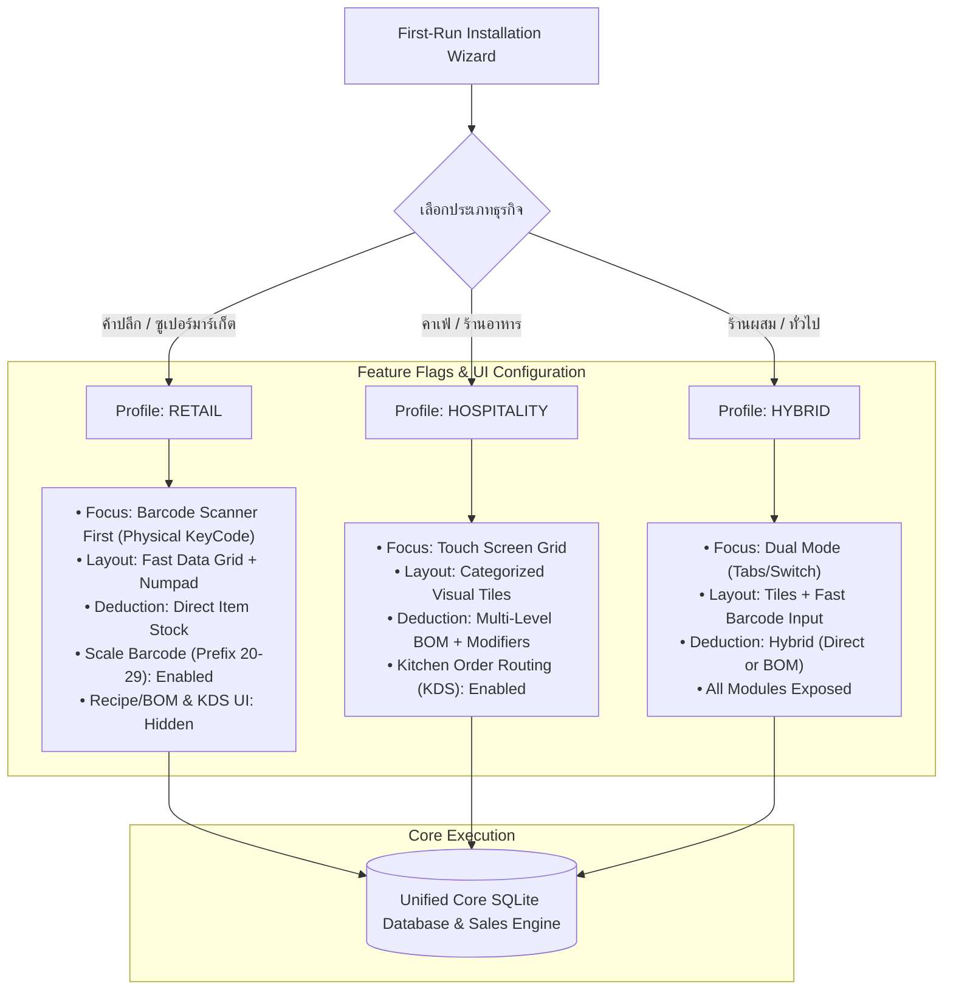
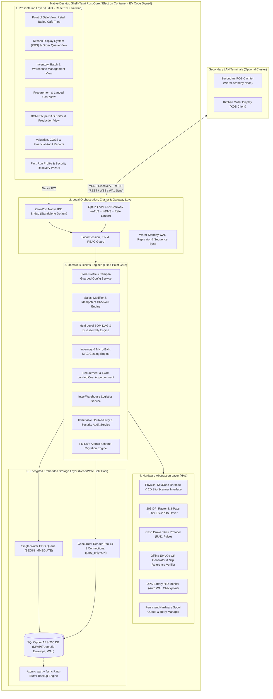
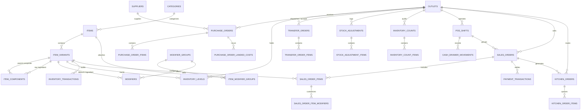
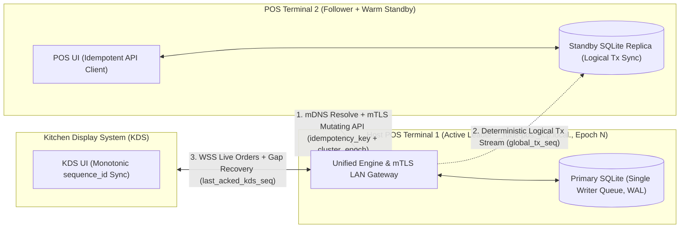
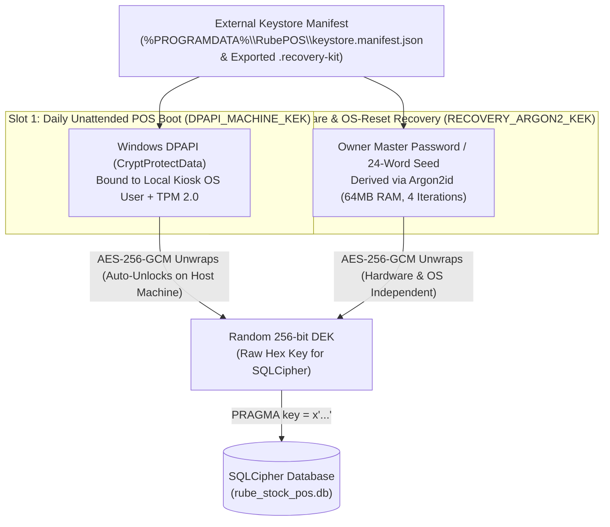

# ARCHITECTURE.md: Unified Local-First Warehouse & POS System (v3.1 Implementation-Hardened Blueprint)

**System Name:** RUBE-STOCK-POS

**Document Version:** 3.1.0 (Enterprise Production & Audit-Hardened Specification)

**Architectural Style:** Profile-Driven Modular Local-First Architecture (Desktop Shell + High-Availability Local Cluster)

**Target Environment:** Windows Standalone / Local LAN Multi-Terminal (100% Air-Gapped Capable)

**Desktop Runtime Shell:** Tauri v2 Native Rust Engine + WebView2 UI (`specta` Type-Safe IPC, EV Code-Signed)

**Storage Engine:** Embedded SQLite 3 with SQLCipher (AES-256-CBC, External Keystore Manifest + Read/Write Split Pool, WAL Mode, Strict ACID)

**Numeric Precision Standard:** 100% Fixed-Point Scaled Integer (`i64` Storage + `i128` Intermediate Math, Zero IEEE-754 Floating-Point Drift)

**Security & Privacy:** 100% Data Sovereignty, Zero-Cloud Telemetry, External Keystore Envelope (DPAPI + Argon2id Recovery), BOT Mini-QR + Visual Anti-Fraud

---

## 1. Executive Summary & Architectural Vision

**RUBE-STOCK-POS** ได้รับการออกแบบขึ้นเพื่อแก้ปัญหาความขัดแย้งดั้งเดิมระหว่างระบบ Cloud POS ทั่วไป กับความต้องการของผู้ประกอบการที่ต้องการ **ความเป็นส่วนตัวของข้อมูลสูงสุด (100% Data Sovereignty)**, **ความเสถียรในการทำงานได้ 100% แม้ไม่มีอินเทอร์เน็ต (Air-Gapped Operation)**, และ **ความแม่นยำระดับบัญชีการเงิน**

ระบบผสานรวม 2 ขั้วธุรกิจหลักเข้าไว้ใน **แกนประมวลผลเดี่ยว (Single Unified Engine)**:

1. **ธุรกิจค้าปลีก / ซูเปอร์มาร์เก็ต (Retail & Supermarket):** เน้นความเร็วในการสแกนบาร์โค้ดต่อเนื่อง (High-Throughput Barcode Scanning), ค้นหาสินค้าทันที, รองรับบาร์โค้ดชั่งน้ำหนักและฝังราคาสด (Dual-Mode Weight/Price EAN-13), และการตัดสต็อกสินค้าสำเร็จรูปโดยตรง (Direct Unit Deduction)
2. **ธุรกิจคาเฟ่ / ร้านอาหาร (Cafe & Hospitality):** เน้นหน้าจอสัมผัส (Touchscreen UI), การตัดสต็อกวัตถุดิบตามสูตรหลายระดับ (Multi-Level Bill of Materials - BOM / Recipe Management ทั้งแบบผลิตล่วงหน้าและตัดสด), ตัวเลือกสินค้าเสริมที่ผูกตามบทบาทวัตถุดิบ (Role-Based & Stock-Aware Modifiers), การส่งออเดอร์เข้าจอครัว (Kitchen Display System - KDS), และการพิมพ์ใบสั่งครัว/ใบเสร็จความร้อน

ด้วยแนวคิด **"Profile-Driven Onboarding"** ผู้ใช้สามารถเลือกประเภทธุรกิจของตนเองได้ตั้งแต่ขั้นตอนติดตั้งครั้งแรก (First-Run Wizard) โดยระบบจะปรับเปลี่ยนส่วนต่อประสาน (UI/UX) และเปิด-ปิดกฎเกณฑ์ทางธุรกิจ (Business Rules) ให้สอดคล้องกับธุรกิจนั้น ๆ โดยอัตโนมัติภายใต้ฐานข้อมูลและโค้ดเบสชุดเดียวกัน

### ยกระดับความแข็งแกร่งระดับใช้งานจริง (v3.1 Implementation-Hardened Enhancements):

* **Fixed-Point Scaled Integer Engine (`i64` Storage + `i128` Intermediate Math):** ขจัดปัญหาทศนิยมคลาดเคลื่อนจากการปัดเศษของเลข Floating-Point โดยจัดเก็บปริมาณสต็อกในหน่วยพันส่วน ($\text{Milli-Units}, \times 10^3$) และต้นทุนเฉลี่ยในหน่วยไมโครบาท ($\text{Micro-Baht}, \times 10^6$) พร้อมบังคับใช้ตัวแปร `i128` ในการคูณ/หารระหว่างทางเพื่อป้องกัน Integer Overflow 100%
* **SQLite Read/Write Split Queue & Early SQLCipher Integration:** แยก Connection Pool สำหรับเขียนเพียง 1 เส้น (ผ่าน In-Memory FIFO Queue ร่วมกับ `BEGIN IMMEDIATE`) ออกจาก Connection Pool สำหรับอ่าน $4\text{--}8\text{ เส้น}$ (`query_only = ON`) ขจัดข้อผิดพลาด `SQLITE_BUSY` 100%
* **External Keystore Manifest (แก้ปัญหา Bootstrap Paradox ของ DPAPI + Argon2id):** แยกส่วนหัวกุญแจเข้ารหัส (`keystore.manifest.json`) ออกมาอยู่นอกไฟล์ฐานข้อมูล SQLCipher เพื่อให้ปลดล็อกกุญแจ `DEK` ตอนเปิดเครื่องกะเช้าด้วย Windows DPAPI / TPM 2.0 ได้ทันที และสามารถใช้รหัสผ่านเจ้าของร้าน (`Argon2id`) กู้คืนฐานข้อมูลได้ทั้งกรณีเปลี่ยนเมนบอร์ดใหม่และกรณีรีเซ็ตรหัสผ่าน Windows บนเครื่องเดิม
* **Thai Hardware Edge-Case Immunity:** ดักจับบาร์โค้ดระดับ USB Device Handle (`WM_INPUT`) ร่วมกับรหัสปุ่มกายภาพ (`KeyboardEvent.code` + First-Char Rollback), รองรับบาร์โค้ดตราชั่งทั้งแบบฝังน้ำหนักและฝังราคา, และพิมพ์ใบเสร็จด้วยโหมด **Chunked Band Raster Bit-Image (`GS v 0` แบ่งแถบละ $64\text{--}128\text{ px}$)** แก้ปัญหาสระลอยและป้องกันบัฟเฟอร์เครื่องพิมพ์ราคาประหยัดล้น 100%
* **ZeroConf mDNS, mTLS, Logical Replication & Epoch Fencing:** ค้นหาเครื่องแม่ข่ายในวงแลนอัตโนมัติด้วย mDNS พร้อมระบบซิงค์ข้อมูลสำรองด้วย `global_tx_seq` (ไม่พังเมื่อเกิด `wal_checkpoint`) และป้องกันปัญหาเครื่องแม่ข่ายชนกัน (Split-Brain) ด้วย `cluster_epoch` Fencing Token
* **Complete Shift Management, Thai VAT ABB & FK-Safe Atomic Migration:** รองรับระบบเปิด-ปิดกะแคชเชียร์ (`pos_shifts`), การนำเงินเข้า-ออกลิ้นชัก (`cash_drawer_movements`), ใบกำกับภาษีอย่างย่อ (ABB), โปรโตคอลอัปเกรดฐานข้อมูล 5 ขั้นตอน และระบบสำรองข้อมูลลง USB แบบ `.part` + `fsync` 14 กะย้อนหลัง

---

## 2. Business Profiles & Dynamic Behavioral Modes

ระบบใช้หลักการ **Polymorphic Business Profile** กำหนดพฤติกรรมของระบบผ่านตัวแปรการตั้งค่าในระดับฐานข้อมูล (`store_config`) ร่วมกับระบบจัดการบาร์โค้ดอัจฉริยะ



### Feature Comparison Matrix

| ความสามารถ (Capabilities) | โหมดค้าปลีก (Retail) | โหมดคาเฟ่/ร้านอาหาร (Cafe) | โหมดไฮบริด (Hybrid) |
| :--- | :---: | :---: | :---: |
| **Global Barcode Listener ($< 50\text{ ms}$, Physical `KeyboardEvent.code`)** | เปิดใช้งานอัตโนมัติ | เปิดใช้งาน (รองรับเสริม) | เปิดใช้งานอัตโนมัติ |
| **รองรับบาร์โค้ดชั่งน้ำหนักสด (EAN-13 Prefix 20-29)** | **เปิดใช้งานเป็นหลัก** | ปิดการแสดงผล | เปิดใช้งาน |
| **หน้าจอขายเริ่มต้น** | Cashier Table / Search | Touch Grid (ปุ่มรูปเมนู) | สลับหน้าจอได้ทั้ง 2 โหมด |
| **การตัดสต็อกวัตถุดิบหลายระดับ (Multi-Level BOM)** | ปิดการแสดงผล | **เปิดใช้งานเป็นหลัก** | **เปิดใช้งานเป็นหลัก** |
| **ตัวเลือกสินค้าเสริมผูกสต็อก (Stock-Aware Modifiers)** | ปิดการแสดงผล | **เปิดใช้งาน (ความหวาน/ท็อปปิ้ง)** | **เปิดใช้งาน** |
| **รองรับจอครัว (KDS) & เครื่องพิมพ์แยกจุด** | ไม่ใช้งาน | **เปิดใช้งาน** | เปิดใช้งาน |
| **การพิมพ์ใบเสร็จ Raster ESC/POS & ลิ้นชักเก็บเงิน** | เปิดใช้งาน | เปิดใช้งาน | เปิดใช้งาน |
| **การคำนวณต้นทุนถัวเฉลี่ยความละเอียดสูง (MAC)** | เปิดใช้งาน | เปิดใช้งาน | เปิดใช้งาน |
| **ระบบตรวจสอบสลิปโอนเงินซ้ำแบบออฟไลน์** | เปิดใช้งาน | เปิดใช้งาน | เปิดใช้งาน |
| **Multi-Terminal LAN (mDNS + mTLS + Warm-Standby)** | รองรับ (ลูกข่ายสแกน) | รองรับ (จอครัว/จุดสั่ง) | รองรับครบทุกจุด |

---

## 3. High-Level System & Process Architecture

ระบบถูกแบ่งออกเป็น 5 เลเยอร์หลักตามหลักการ **Clean Architecture** และห่อหุ้มด้วย **Native Desktop Container** ที่บังคับใช้มาตรการความปลอดภัยระดับโปรเซส:



### 3.1. แนวทางปฏิบัติในการรวมศูนย์ Runtime และการแยกโหมดเครือข่าย (Runtime & Network Isolation)

1. **Standardized Native Rust Core (Tauri v2 + Type-Safe IPC):**
   * ระบบกำหนดมาตรฐานเดี่ยวเป็น **Tauri v2 + Rust Core** โดยเขียนชั้น `Local Orchestration`, `Domain Business Engines`, และ `Storage Layer` ด้วยภาษา **Rust** ทั้งหมด (ใช้ไลบรารี `rusqlite` เปิดฟีเจอร์ `bundled-sqlcipher-vendored-openssl` ร่วมกับ `axum` และ `tokio`) และใช้ `specta` สร้างไฟล์ TypeScript DTOs ใน `packages/shared-contracts` อัตโนมัติ ได้ไฟล์ติดตั้ง `.exe` / `.msi` เดี่ยวขนาดเล็ก ($10\text{--}15\text{ MB}$) ไม่ต้องพึ่งพา Node.js หรือ Visual C++ Redistributable และป้องกันการถอดรหัสซอร์สโค้ดย้อนกลับ (Reverse Engineering) ได้อย่างเด็ดขาด
2. **IPC-Only Standalone Isolation (ปิดพอร์ตเครือข่าย 100% ในโหมดเครื่องเดียว):**
   * ในโหมดเครื่องเดียว (`Standalone Mode`) ระบบจะสื่อสารระหว่าง UI และ Backend ผ่าน **Native IPC Bridge** ของ Tauri เท่านั้น **ห้ามเปิด TCP Port (`3001`) บน Loopback หรือ Network Interface โดยเด็ดขาด** เพื่อป้องกันมัลแวร์หรือโปรแกรมอื่นบนเครื่องเดียวกันแอบยิงคำขอเข้าสู่ API ท้องถิ่น
   * ระบบจะเปิดพอร์ต TCP/WebSocket ของ `LAN_GW` เฉพาะเมื่อเจ้าของร้านเปิดใช้งานโหมด `Multi-Terminal Cluster Mode` และยืนยันรหัสผ่านผู้ดูแลระบบแล้วเท่านั้น
3. **EV Code Signing & Kiosk Hardening:**
   * เนื่องจากระบบมีการดักจับสัญญาณ USB Raw Input (`WM_INPUT`) และคีย์บอร์ดสำหรับเครื่องสแกนบาร์โค้ด ตัวติดตั้ง `.exe` / `.msi` และไบนารีทั้งหมดต้องลงนามด้วย **Extended Validation (EV) Code Signing Certificate** เพื่อป้องกัน Windows Defender SmartScreen บล็อกการทำงานเพราะเข้าใจผิดว่าเป็น Keylogger

---

## 4. Database Architecture, Read/Write Concurrency & Entity Relationships

### 4.1. มาตรฐานการเก็บตัวเลขแบบ Fixed-Point Scaled Integer (`i64` Storage + `i128` Intermediate Math)

เพื่อป้องกันปัญหาทศนิยมคลาดเคลื่อน (IEEE 754 Floating-Point Drift), การปัดเศษทิ้งก่อนเวลาอันควรในสูตรวัตถุดิบ, และปัญหา **Integer Overflow** เมื่อคูณปริมาณสต็อกกับต้นทุนระดับไมโครบาท ระบบกำหนดมาตรฐานชนิดข้อมูลดังนี้:

* **การจัดเก็บในฐานข้อมูล (Storage Type):** ใช้ชนิดข้อมูล `INTEGER` (64-bit Signed Integer / `i64` ใน Rust) สำหรับค่าตัวเลขทุกชนิด
* **การคำนวณระหว่างทาง (Intermediate Computation Rule):** ห้ามคูณหรือหารตัวเลขในระดับ `i64` หรือ `number` ของ JavaScript โดยตรงเด็ดขาด! ทุกฟังก์ชันคำนวณต้นทุน (`costing_mac.rs`) และสูตรการผลิต (`bom_dag.rs`) ต้องแปลงค่าเป็น **`i128` (128-bit Signed Integer ใน Rust)** ก่อนทำการคูณและหารเสมอ แล้วจึงย่อสเกลกลับเป็น `i64` พร้อมใช้ฟังก์ชันปัดเศษแบบครึ่งปัดออกจากศูนย์บนค่าสัมบูรณ์ ($\text{round\_div}(a, b) = \text{sgn}(a) \times \lfloor (\lvert a \rvert + \lfloor b / 2 \rfloor) / b \rfloor$)
* **การส่งข้อมูลข้าม IPC (Serialization Rule):** สำหรับฟิลด์ที่มีโอกาสเกินค่า $2^{53} - 1$ (`Number.MAX_SAFE_INTEGER` ใน JavaScript) เช่น ยอดต้นทุนสะสมระดับไมโครบาท ให้ส่งผ่าน IPC ในรูปแบบสตริงตัวเลข (`Branded Numeric String`) หรือคำนวณผลลัพธ์เสร็จสมบูรณ์จากฝั่ง Rust

| ประเภทข้อมูล | หน่วยที่จัดเก็บในฐานข้อมูล | ตัวคูณสเกล (Scale Factor) | ตัวอย่างการแปลงค่า |
| :--- | :--- | :---: | :--- |
| **ปริมาณสต็อกและสูตร BOM** (`*_milli`) | มิลลิยูนิต (Milli-Units) | $\times 10^3$ ($1,000$) | สต็อก $1.5\text{ กก.} = 1,500$, ตัดสูตร $0.025\text{ ลิตร} = 25$ |
| **ราคาขายและยอดเงินในบิล** (`*_satang`) | สตางค์ (Satang / Cents) | $\times 10^2$ ($100$) | ราคาขาย $65.00\text{ บาท} = 6,500\text{ สตางค์}$ |
| **ต้นทุนต่อหน่วยและต้นทุนเฉลี่ย MAC** (`*_micro_baht`) | ไมโครบาท (Micro-Baht) | $\times 10^6$ ($1,000,000$) | ต้นทุนเกลือ $0.0125\text{ บาท/กรัม} = 12,500\text{ ไมโครบาท}$ |
| **อัตราภาษีและส่วนลดเปอร์เซ็นต์** (`*_basis_points`) | เบซิสพอยต์ (Basis Points) | $\times 10^4$ ($10,000$) | ภาษีมูลค่าเพิ่ม $7.00\% = 700\text{ bps}$ |

### 4.2. สถาปัตยกรรม Connection Pool แยกอ่าน-เขียน (SQLite Read/Write Split Queue)

แม้โหมด WAL จะอนุญาตให้อ่านและเขียนข้อมูลพร้อมกันได้ แต่ SQLite รองรับการเขียนได้เพียง 1 การเชื่อมต่อในเวลาเดียวกัน (Single-Writer Lock) เพื่อป้องกันข้อผิดพลาด `SQLITE_BUSY` เมื่อแคชเชียร์หลายเครื่องคิดเงินพร้อมกับการรับของเข้าคลัง ระบบจึงบังคับใช้โครงสร้าง Connection Pool ดังนี้:

1. **Dedicated Writer Connection (จำนวน 1 เส้น):**
   * คำสั่งเปลี่ยนแปลงข้อมูลทุกชนิด (`INSERT`, `UPDATE`, `DELETE`) ต้องส่งเข้า **In-Memory FIFO Serialization Queue** ในระดับแอปพลิเคชันเพื่อเรียงคิวทำงานทีละธุรกรรมผ่าน Writer Connection เส้นเดียว
   * ทุกธุรกรรมฝั่งเขียนต้องเปิดด้วยคำสั่ง `BEGIN IMMEDIATE TRANSACTION;` เสมอ (ห้ามใช้ `BEGIN` เฉยๆ ซึ่งจะเริ่มในโหมด `DEFERRED` แล้วเสี่ยงเกิด Deadlock เมื่ออัปเกรดล็อกกลางคัน)
2. **Concurrent Reader Connection Pool (จำนวน $4\text{--}8\text{ เส้น}$):**
   * ตั้งค่า `PRAGMA query_only = ON;` ทุกเส้น ใช้สำหรับค้นหาสินค้าหน้าเคาน์เตอร์, คำนวณหน้าจอ KDS, และดึงรายงานการเงินขนาดใหญ่โดยไม่บล็อกคิวการเขียน
3. **Production SQLCipher PRAGMA Initialization:**
   ทุก Connection ที่เปิดขึ้นมาต้องรันชุดคำสั่งเริ่มต้นต่อไปนี้ โดยส่งกุญแจเป็น **Raw Hex Key (64 ตัวอักษรฐานสิบหก)** แทนรหัสผ่านตัวอักษร เพื่อข้ามการคำนวณ PBKDF2 ซ้ำซ้อนในทุก Connection:
   ```sql
   PRAGMA key = "x'98483C6EB40B6C31A448C22A66DED3B5E5E8D5119CAC8327B655C8B5C4836489'";
   PRAGMA cipher_page_size = 4096;
   PRAGMA journal_mode = WAL;
   PRAGMA synchronous = NORMAL;
   PRAGMA wal_autocheckpoint = 1000;
   PRAGMA busy_timeout = 5000;
   PRAGMA foreign_keys = ON;
   PRAGMA temp_store = MEMORY;
   PRAGMA mmap_size = 268435456; -- 256MB Memory-Mapped I/O for fast reads
   ```

### 4.3. Complete Entity Relationship Diagram (ERD)



### 4.4. External Bootstrap Keystore Manifest & Complete Production SQLite DDL Schema

#### 4.4.1. External Keystore Manifest (`%PROGRAMDATA%\RubePOS\keystore.manifest.json`)
เนื่องจากฐานข้อมูล `rube_stock_pos.db` ถูกเข้ารหัสระดับเพจด้วย SQLCipher แอปพลิเคชันจึงไม่สามารถ `SELECT` กุญแจ `DEK` จากตารางภายในฐานข้อมูลก่อนปลดล็อกได้ (Bootstrap Paradox) ระบบจึงแยกส่วนหัวกุญแจ (Envelope Header) ออกมาเก็บไว้ในไฟล์ **`keystore.manifest.json`** นอกฐานข้อมูล (และคัดลอกแนบไปกับไฟล์ `.recovery-kit` ทุกครั้ง) โดยมีโครงสร้างดังนี้:
* **`dpapi_slot`:** เก็บ `wrapped_dek_dpapi_hex` ที่เข้ารหัสด้วย Windows `CryptProtectData` ผูกกับเครื่อง POS สำหรับเปิดเครื่องอัตโนมัติตอนเช้า (Unattended Boot)
* **`argon2_recovery_slot`:** เก็บ `kdf_salt_hex`, `kdf_memory_kb` ($65536$), `kdf_iterations` ($4$), `iv_hex`, `auth_tag_hex`, และ `wrapped_dek_argon2_hex` ไว้บนเครื่องหลักด้วย เพื่อให้เจ้าของร้านสามารถใช้รหัสผ่านหลัก/Seed 24 คำปลดล็อกฐานข้อมูลได้ทันทีแม้กรณีที่ช่างคอมพิวเตอร์รีเซ็ตรหัสผ่าน Windows User จนทำให้ DPAPI เดิมใช้การไม่ได้

#### 4.4.2. Complete Production SQLite DDL Schema (34 Tables)
สคริปต์โครงสร้างฐานข้อมูลฉบับสมบูรณ์ที่บังคับใช้ Foreign Keys, Check Constraints, ชนิดข้อมูลแบบ Fixed-Point, `pos_shifts`, `cash_drawer_movements`, `component_role`, `idempotency_key`, `sequence_id`, และตารางบันทึกความปลอดภัย (`security_audit_logs`):

```sql
PRAGMA foreign_keys = ON;
PRAGMA journal_mode = WAL;
PRAGMA synchronous = NORMAL;

-- 1. System Configuration, Internal Cluster Keyring, Audit Logs & Schema Migrations
CREATE TABLE store_config (
    key TEXT PRIMARY KEY,
    value TEXT NOT NULL,
    is_protected INTEGER NOT NULL DEFAULT 0 CHECK (is_protected IN (0, 1)),
    hmac_signature_hex TEXT,
    updated_by TEXT,
    updated_at TEXT NOT NULL DEFAULT (strftime('%Y-%m-%dT%H:%M:%fZ', 'now'))
);

-- Stores internal PKI/Cluster keys after DB unlock, plus a mirrored audit copy of envelope slots
CREATE TABLE security_keyring (
    key_id TEXT PRIMARY KEY,
    key_purpose TEXT NOT NULL CHECK (key_purpose IN ('DPAPI_MACHINE_KEK', 'RECOVERY_ARGON2_KEK', 'INTERNAL_ROOT_CA', 'LAN_CLUSTER_PSK')),
    kdf_algorithm TEXT NOT NULL DEFAULT 'ARGON2ID',
    kdf_salt_hex TEXT NOT NULL,
    kdf_iterations INTEGER NOT NULL,
    kdf_memory_kb INTEGER NOT NULL,
    wrapped_dek_cipher_hex TEXT NOT NULL,
    iv_hex TEXT NOT NULL,
    auth_tag_hex TEXT NOT NULL,
    created_at TEXT NOT NULL DEFAULT (strftime('%Y-%m-%dT%H:%M:%fZ', 'now'))
);

CREATE TABLE security_audit_logs (
    id INTEGER PRIMARY KEY AUTOINCREMENT,
    event_type TEXT NOT NULL,
    actor_user_id TEXT,
    terminal_id TEXT,
    target_key TEXT,
    old_value_redacted TEXT,
    new_value_redacted TEXT,
    created_at TEXT NOT NULL DEFAULT (strftime('%Y-%m-%dT%H:%M:%fZ', 'now'))
);

CREATE TABLE schema_migrations (
    version INTEGER PRIMARY KEY,
    name TEXT NOT NULL,
    checksum TEXT NOT NULL,
    execution_ms INTEGER NOT NULL,
    applied_at TEXT NOT NULL DEFAULT (strftime('%Y-%m-%dT%H:%M:%fZ', 'now'))
);

-- 2. Outlets, Terminals (with Epoch Fencing), Users & Cashier Shifts
CREATE TABLE outlets (
    id TEXT PRIMARY KEY,
    code TEXT NOT NULL UNIQUE,
    name TEXT NOT NULL,
    tax_id TEXT,
    branch_code TEXT NOT NULL DEFAULT '00000',
    rd_pos_reg_no TEXT,
    is_warehouse INTEGER NOT NULL DEFAULT 0 CHECK (is_warehouse IN (0, 1)),
    active INTEGER NOT NULL DEFAULT 1 CHECK (active IN (0, 1)),
    created_at TEXT NOT NULL DEFAULT (strftime('%Y-%m-%dT%H:%M:%fZ', 'now'))
);

CREATE TABLE pos_terminals (
    id TEXT PRIMARY KEY,
    outlet_id TEXT NOT NULL REFERENCES outlets(id),
    terminal_name TEXT NOT NULL,
    role TEXT NOT NULL CHECK (role IN ('LEADER', 'FOLLOWER_POS', 'FOLLOWER_KDS')),
    cluster_epoch INTEGER NOT NULL DEFAULT 1 CHECK (cluster_epoch >= 1),
    client_cert_fingerprint TEXT UNIQUE,
    ip_address TEXT,
    last_heartbeat_at TEXT,
    last_replicated_tx_seq INTEGER NOT NULL DEFAULT 0,
    last_acked_kds_seq INTEGER NOT NULL DEFAULT 0,
    active INTEGER NOT NULL DEFAULT 1 CHECK (active IN (0, 1))
);

CREATE TABLE users (
    id TEXT PRIMARY KEY,
    username TEXT NOT NULL UNIQUE,
    display_name TEXT NOT NULL,
    role TEXT NOT NULL CHECK (role IN ('OWNER', 'MANAGER', 'CASHIER', 'WAREHOUSE', 'KITCHEN')),
    pin_hash TEXT NOT NULL,
    active INTEGER NOT NULL DEFAULT 1 CHECK (active IN (0, 1)),
    created_at TEXT NOT NULL DEFAULT (strftime('%Y-%m-%dT%H:%M:%fZ', 'now'))
);

CREATE TABLE pos_shifts (
    id TEXT PRIMARY KEY,
    shift_number TEXT NOT NULL UNIQUE,
    outlet_id TEXT NOT NULL REFERENCES outlets(id),
    terminal_id TEXT NOT NULL REFERENCES pos_terminals(id),
    opened_by TEXT NOT NULL REFERENCES users(id),
    closed_by TEXT REFERENCES users(id),
    status TEXT NOT NULL DEFAULT 'OPEN' CHECK (status IN ('OPEN', 'CLOSED')),
    opening_cash_satang INTEGER NOT NULL DEFAULT 0 CHECK (opening_cash_satang >= 0),
    expected_cash_satang INTEGER NOT NULL DEFAULT 0,
    counted_cash_satang INTEGER,
    cash_variance_satang INTEGER,
    notes TEXT,
    opened_at TEXT NOT NULL DEFAULT (strftime('%Y-%m-%dT%H:%M:%fZ', 'now')),
    closed_at TEXT
);

CREATE TABLE cash_drawer_movements (
    id TEXT PRIMARY KEY,
    shift_id TEXT NOT NULL REFERENCES pos_shifts(id) ON DELETE RESTRICT,
    movement_type TEXT NOT NULL CHECK (movement_type IN ('OPENING_FLOAT', 'PAID_IN', 'PAID_OUT', 'CASH_DROP')),
    amount_satang INTEGER NOT NULL CHECK (amount_satang > 0),
    reason TEXT NOT NULL,
    performed_by TEXT NOT NULL REFERENCES users(id),
    created_at TEXT NOT NULL DEFAULT (strftime('%Y-%m-%dT%H:%M:%fZ', 'now'))
);

-- 3. Catalog, Variants, Multi-Level BOM (with Component Roles) & Stock-Aware Modifiers
CREATE TABLE categories (
    id TEXT PRIMARY KEY,
    name TEXT NOT NULL,
    display_color TEXT NOT NULL DEFAULT '#3B82F6',
    kitchen_station TEXT DEFAULT 'MAIN',
    sort_order INTEGER NOT NULL DEFAULT 0
);

CREATE TABLE items (
    id TEXT PRIMARY KEY,
    name TEXT NOT NULL,
    category_id TEXT REFERENCES categories(id),
    unit_name TEXT NOT NULL DEFAULT 'ชิ้น',
    track_stock INTEGER NOT NULL DEFAULT 1 CHECK (track_stock IN (0, 1)),
    is_composite INTEGER NOT NULL DEFAULT 0 CHECK (is_composite IN (0, 1)),
    use_production INTEGER NOT NULL DEFAULT 0 CHECK (use_production IN (0, 1)),
    is_weighted_scale INTEGER NOT NULL DEFAULT 0 CHECK (is_weighted_scale IN (0, 1)),
    active INTEGER NOT NULL DEFAULT 1 CHECK (active IN (0, 1)),
    created_at TEXT NOT NULL DEFAULT (strftime('%Y-%m-%dT%H:%M:%fZ', 'now'))
);

CREATE TABLE item_variants (
    id TEXT PRIMARY KEY,
    item_id TEXT NOT NULL REFERENCES items(id) ON DELETE CASCADE,
    variant_name TEXT NOT NULL DEFAULT 'ปกติ',
    sku TEXT NOT NULL UNIQUE,
    barcode TEXT UNIQUE,
    price_satang INTEGER NOT NULL DEFAULT 0 CHECK (price_satang >= 0),
    default_purchase_cost_micro_baht INTEGER NOT NULL DEFAULT 0 CHECK (default_purchase_cost_micro_baht >= 0),
    active INTEGER NOT NULL DEFAULT 1 CHECK (active IN (0, 1))
);

CREATE INDEX idx_item_variants_barcode ON item_variants(barcode);
CREATE INDEX idx_item_variants_sku ON item_variants(sku);

CREATE TABLE item_components (
    id TEXT PRIMARY KEY,
    composite_variant_id TEXT NOT NULL REFERENCES item_variants(id) ON DELETE CASCADE,
    component_variant_id TEXT NOT NULL REFERENCES item_variants(id) ON DELETE RESTRICT,
    component_role TEXT NOT NULL DEFAULT 'STANDARD' CHECK (
        component_role IN ('STANDARD', 'SWEETENER', 'MILK_BASE', 'COFFEE_SHOT', 'TEA_BASE', 'TOPPING', 'PACKAGING')
    ),
    quantity_milli INTEGER NOT NULL CHECK (quantity_milli > 0),
    wastage_basis_points INTEGER NOT NULL DEFAULT 0 CHECK (wastage_basis_points >= 0),
    UNIQUE(composite_variant_id, component_variant_id),
    CHECK (composite_variant_id != component_variant_id)
);

CREATE TABLE modifier_groups (
    id TEXT PRIMARY KEY,
    name TEXT NOT NULL,
    selection_type TEXT NOT NULL CHECK (selection_type IN ('SINGLE', 'MULTIPLE')),
    min_selections INTEGER NOT NULL DEFAULT 0 CHECK (min_selections >= 0),
    max_selections INTEGER NOT NULL DEFAULT 1 CHECK (max_selections >= 1)
);

CREATE TABLE item_modifier_groups (
    item_id TEXT NOT NULL REFERENCES items(id) ON DELETE CASCADE,
    modifier_group_id TEXT NOT NULL REFERENCES modifier_groups(id) ON DELETE CASCADE,
    sort_order INTEGER NOT NULL DEFAULT 0,
    PRIMARY KEY (item_id, modifier_group_id)
);

CREATE TABLE modifiers (
    id TEXT PRIMARY KEY,
    modifier_group_id TEXT NOT NULL REFERENCES modifier_groups(id) ON DELETE CASCADE,
    name TEXT NOT NULL,
    price_delta_satang INTEGER NOT NULL DEFAULT 0,
    modifier_mode TEXT NOT NULL DEFAULT 'FIXED_QTY_DELTA' CHECK (modifier_mode IN ('FIXED_QTY_DELTA', 'ROLE_SCALE_BPS')),
    component_variant_id TEXT REFERENCES item_variants(id) ON DELETE SET NULL,
    quantity_delta_milli INTEGER NOT NULL DEFAULT 0,
    target_component_role TEXT CHECK (
        target_component_role IS NULL OR target_component_role IN ('STANDARD', 'SWEETENER', 'MILK_BASE', 'COFFEE_SHOT', 'TEA_BASE', 'TOPPING', 'PACKAGING')
    ),
    scale_basis_points INTEGER NOT NULL DEFAULT 0,
    sort_order INTEGER NOT NULL DEFAULT 0
);

-- 4. Inventory Levels & Immutable Double-Entry Audit Ledger
CREATE TABLE inventory_levels (
    id TEXT PRIMARY KEY,
    outlet_id TEXT NOT NULL REFERENCES outlets(id) ON DELETE CASCADE,
    variant_id TEXT NOT NULL REFERENCES item_variants(id) ON DELETE CASCADE,
    in_stock_milli INTEGER NOT NULL DEFAULT 0,
    average_cost_micro_baht INTEGER NOT NULL DEFAULT 0 CHECK (average_cost_micro_baht >= 0),
    optimal_stock_milli INTEGER NOT NULL DEFAULT 0,
    low_stock_threshold_milli INTEGER NOT NULL DEFAULT 0,
    updated_at TEXT NOT NULL DEFAULT (strftime('%Y-%m-%dT%H:%M:%fZ', 'now')),
    UNIQUE(outlet_id, variant_id)
);

CREATE TABLE inventory_transactions (
    id TEXT PRIMARY KEY,
    outlet_id TEXT NOT NULL REFERENCES outlets(id),
    variant_id TEXT NOT NULL REFERENCES item_variants(id),
    transaction_type TEXT NOT NULL CHECK (
        transaction_type IN ('PO_RECEIVE', 'SALE_DIRECT', 'SALE_BOM', 'SALE_MODIFIER', 'VOID_RETURN', 'TRANSFER_OUT', 'TRANSFER_IN', 'ADJUSTMENT', 'RE_COUNT', 'PRODUCTION_BUILD')
    ),
    quantity_change_milli INTEGER NOT NULL,
    stock_before_milli INTEGER NOT NULL,
    stock_after_milli INTEGER NOT NULL,
    unit_cost_micro_baht INTEGER NOT NULL CHECK (unit_cost_micro_baht >= 0),
    reference_type TEXT NOT NULL,
    reference_id TEXT NOT NULL,
    performed_by TEXT REFERENCES users(id),
    created_at TEXT NOT NULL DEFAULT (strftime('%Y-%m-%dT%H:%M:%fZ', 'now'))
);

CREATE INDEX idx_inv_tx_outlet_variant_date ON inventory_transactions(outlet_id, variant_id, created_at);
CREATE INDEX idx_inv_tx_reference ON inventory_transactions(reference_type, reference_id);

-- Triggers enforcing Immutable Ledger on inventory_transactions and security_audit_logs
CREATE TRIGGER trg_prevent_inv_tx_update
BEFORE UPDATE ON inventory_transactions
BEGIN
    SELECT RAISE(ABORT, 'Immutable Ledger Violation: inventory_transactions cannot be updated');
END;

CREATE TRIGGER trg_prevent_inv_tx_delete
BEFORE DELETE ON inventory_transactions
BEGIN
    SELECT RAISE(ABORT, 'Immutable Ledger Violation: inventory_transactions cannot be deleted');
END;

CREATE TRIGGER trg_prevent_sec_audit_mutation
BEFORE DELETE ON security_audit_logs
BEGIN
    SELECT RAISE(ABORT, 'Immutable Audit Violation: security_audit_logs cannot be deleted');
END;

-- 5. Procurement, Landed Costs, Transfers, Adjustments & Stocktakes
CREATE TABLE suppliers (
    id TEXT PRIMARY KEY,
    code TEXT NOT NULL UNIQUE,
    name TEXT NOT NULL,
    tax_id TEXT,
    phone TEXT,
    active INTEGER NOT NULL DEFAULT 1 CHECK (active IN (0, 1))
);

CREATE TABLE purchase_orders (
    id TEXT PRIMARY KEY,
    po_number TEXT NOT NULL UNIQUE,
    outlet_id TEXT NOT NULL REFERENCES outlets(id),
    supplier_id TEXT NOT NULL REFERENCES suppliers(id),
    status TEXT NOT NULL CHECK (status IN ('DRAFT', 'ISSUED', 'PARTIALLY_RECEIVED', 'RECEIVED', 'CANCELLED')),
    subtotal_satang INTEGER NOT NULL DEFAULT 0,
    total_landed_cost_satang INTEGER NOT NULL DEFAULT 0,
    grand_total_satang INTEGER NOT NULL DEFAULT 0,
    received_at TEXT,
    created_by TEXT REFERENCES users(id),
    created_at TEXT NOT NULL DEFAULT (strftime('%Y-%m-%dT%H:%M:%fZ', 'now'))
);

CREATE TABLE purchase_order_items (
    id TEXT PRIMARY KEY,
    purchase_order_id TEXT NOT NULL REFERENCES purchase_orders(id) ON DELETE CASCADE,
    variant_id TEXT NOT NULL REFERENCES item_variants(id),
    ordered_qty_milli INTEGER NOT NULL CHECK (ordered_qty_milli > 0),
    received_qty_milli INTEGER NOT NULL DEFAULT 0 CHECK (received_qty_milli >= 0),
    base_unit_cost_micro_baht INTEGER NOT NULL CHECK (base_unit_cost_micro_baht >= 0),
    allocated_landed_cost_micro_baht INTEGER NOT NULL DEFAULT 0 CHECK (allocated_landed_cost_micro_baht >= 0),
    effective_unit_cost_micro_baht INTEGER NOT NULL DEFAULT 0 CHECK (effective_unit_cost_micro_baht >= 0)
);

CREATE TABLE purchase_order_landed_costs (
    id TEXT PRIMARY KEY,
    purchase_order_id TEXT NOT NULL REFERENCES purchase_orders(id) ON DELETE CASCADE,
    cost_type TEXT NOT NULL CHECK (cost_type IN ('FREIGHT', 'CUSTOMS_DUTY', 'INSURANCE', 'HANDLING', 'OTHER')),
    description TEXT NOT NULL,
    amount_satang INTEGER NOT NULL CHECK (amount_satang > 0)
);

CREATE TABLE transfer_orders (
    id TEXT PRIMARY KEY,
    transfer_number TEXT NOT NULL UNIQUE,
    source_outlet_id TEXT NOT NULL REFERENCES outlets(id),
    destination_outlet_id TEXT NOT NULL REFERENCES outlets(id),
    status TEXT NOT NULL CHECK (status IN ('PENDING', 'IN_TRANSIT', 'COMPLETED', 'CANCELLED')),
    dispatched_at TEXT,
    received_at TEXT,
    created_at TEXT NOT NULL DEFAULT (strftime('%Y-%m-%dT%H:%M:%fZ', 'now')),
    CHECK (source_outlet_id != destination_outlet_id)
);

CREATE TABLE transfer_order_items (
    id TEXT PRIMARY KEY,
    transfer_order_id TEXT NOT NULL REFERENCES transfer_orders(id) ON DELETE CASCADE,
    variant_id TEXT NOT NULL REFERENCES item_variants(id),
    quantity_milli INTEGER NOT NULL CHECK (quantity_milli > 0),
    transfer_unit_cost_micro_baht INTEGER NOT NULL CHECK (transfer_unit_cost_micro_baht >= 0)
);

CREATE TABLE stock_adjustments (
    id TEXT PRIMARY KEY,
    adjustment_number TEXT NOT NULL UNIQUE,
    outlet_id TEXT NOT NULL REFERENCES outlets(id),
    reason_code TEXT NOT NULL CHECK (reason_code IN ('DAMAGED', 'EXPIRED', 'INTERNAL_USE', 'THEFT_LOSS', 'FOUND_SURPLUS', 'RE_COUNT')),
    notes TEXT,
    created_by TEXT REFERENCES users(id),
    created_at TEXT NOT NULL DEFAULT (strftime('%Y-%m-%dT%H:%M:%fZ', 'now'))
);

CREATE TABLE stock_adjustment_items (
    id TEXT PRIMARY KEY,
    stock_adjustment_id TEXT NOT NULL REFERENCES stock_adjustments(id) ON DELETE CASCADE,
    variant_id TEXT NOT NULL REFERENCES item_variants(id),
    quantity_delta_milli INTEGER NOT NULL CHECK (quantity_delta_milli != 0),
    unit_cost_micro_baht INTEGER NOT NULL CHECK (unit_cost_micro_baht >= 0)
);

CREATE TABLE inventory_counts (
    id TEXT PRIMARY KEY,
    count_number TEXT NOT NULL UNIQUE,
    outlet_id TEXT NOT NULL REFERENCES outlets(id),
    status TEXT NOT NULL CHECK (status IN ('IN_PROGRESS', 'COMPLETED', 'CANCELLED')),
    total_variance_satang INTEGER NOT NULL DEFAULT 0,
    completed_at TEXT,
    created_by TEXT REFERENCES users(id),
    created_at TEXT NOT NULL DEFAULT (strftime('%Y-%m-%dT%H:%M:%fZ', 'now'))
);

CREATE TABLE inventory_count_items (
    id TEXT PRIMARY KEY,
    inventory_count_id TEXT NOT NULL REFERENCES inventory_counts(id) ON DELETE CASCADE,
    variant_id TEXT NOT NULL REFERENCES item_variants(id),
    expected_stock_milli INTEGER NOT NULL,
    counted_stock_milli INTEGER NOT NULL,
    variance_milli INTEGER NOT NULL,
    snapshot_unit_cost_micro_baht INTEGER NOT NULL,
    variance_cost_satang INTEGER NOT NULL
);

-- 6. Sales Orders (Idempotent + Thai ABB Tax Invoice), Modifiers, Anti-Fraud Payments & Sequence-Synced KDS
CREATE TABLE sales_orders (
    id TEXT PRIMARY KEY,
    idempotency_key TEXT NOT NULL UNIQUE,
    receipt_number TEXT NOT NULL UNIQUE,
    abb_tax_invoice_no TEXT UNIQUE,
    outlet_id TEXT NOT NULL REFERENCES outlets(id),
    terminal_id TEXT NOT NULL REFERENCES pos_terminals(id),
    shift_id TEXT NOT NULL REFERENCES pos_shifts(id),
    cashier_id TEXT NOT NULL REFERENCES users(id),
    order_type TEXT NOT NULL DEFAULT 'TAKEAWAY' CHECK (order_type IN ('RETAIL', 'DINE_IN', 'TAKEAWAY', 'DELIVERY')),
    table_or_queue_no TEXT,
    status TEXT NOT NULL DEFAULT 'COMPLETED' CHECK (status IN ('OPEN', 'COMPLETED', 'VOIDED')),
    tax_mode TEXT NOT NULL DEFAULT 'INCLUSIVE' CHECK (tax_mode IN ('NONE', 'INCLUSIVE', 'EXCLUSIVE')),
    subtotal_satang INTEGER NOT NULL CHECK (subtotal_satang >= 0),
    discount_satang INTEGER NOT NULL DEFAULT 0 CHECK (discount_satang >= 0),
    tax_satang INTEGER NOT NULL DEFAULT 0 CHECK (tax_satang >= 0),
    total_satang INTEGER NOT NULL CHECK (total_satang >= 0),
    total_cogs_micro_baht INTEGER NOT NULL DEFAULT 0 CHECK (total_cogs_micro_baht >= 0),
    voided_by TEXT REFERENCES users(id),
    void_reason TEXT,
    voided_at TEXT,
    created_at TEXT NOT NULL DEFAULT (strftime('%Y-%m-%dT%H:%M:%fZ', 'now'))
);

CREATE INDEX idx_sales_orders_created_at ON sales_orders(outlet_id, created_at);
CREATE INDEX idx_sales_orders_shift ON sales_orders(shift_id);

CREATE TABLE sales_order_items (
    id TEXT PRIMARY KEY,
    sales_order_id TEXT NOT NULL REFERENCES sales_orders(id) ON DELETE CASCADE,
    variant_id TEXT NOT NULL REFERENCES item_variants(id),
    quantity_milli INTEGER NOT NULL CHECK (quantity_milli > 0),
    unit_price_satang INTEGER NOT NULL CHECK (unit_price_satang >= 0),
    modifiers_total_satang INTEGER NOT NULL DEFAULT 0,
    discount_satang INTEGER NOT NULL DEFAULT 0 CHECK (discount_satang >= 0),
    line_total_satang INTEGER NOT NULL CHECK (line_total_satang >= 0),
    line_cogs_micro_baht INTEGER NOT NULL DEFAULT 0 CHECK (line_cogs_micro_baht >= 0),
    notes TEXT
);

CREATE TABLE sales_order_item_modifiers (
    id TEXT PRIMARY KEY,
    sales_order_item_id TEXT NOT NULL REFERENCES sales_order_items(id) ON DELETE CASCADE,
    modifier_id TEXT NOT NULL REFERENCES modifiers(id),
    modifier_name_snapshot TEXT NOT NULL,
    price_delta_satang INTEGER NOT NULL,
    component_variant_id TEXT REFERENCES item_variants(id),
    deducted_qty_milli INTEGER NOT NULL DEFAULT 0,
    modifier_cogs_micro_baht INTEGER NOT NULL DEFAULT 0
);

CREATE TABLE payment_transactions (
    id TEXT PRIMARY KEY,
    sales_order_id TEXT NOT NULL REFERENCES sales_orders(id) ON DELETE CASCADE,
    payment_method TEXT NOT NULL CHECK (payment_method IN ('CASH', 'PROMPTPAY_QR', 'CARD', 'VOUCHER')),
    amount_satang INTEGER NOT NULL CHECK (amount_satang > 0),
    cash_tendered_satang INTEGER,
    change_given_satang INTEGER,
    emvco_payload_crc TEXT,
    sender_bank_code TEXT,
    slip_trans_ref_last4 TEXT,
    slip_trans_ref_hash TEXT UNIQUE,
    verified_by_user_id TEXT REFERENCES users(id),
    created_at TEXT NOT NULL DEFAULT (strftime('%Y-%m-%dT%H:%M:%fZ', 'now'))
);

CREATE TABLE kitchen_orders (
    sequence_id INTEGER PRIMARY KEY AUTOINCREMENT,
    id TEXT NOT NULL UNIQUE,
    sales_order_id TEXT NOT NULL REFERENCES sales_orders(id) ON DELETE CASCADE,
    outlet_id TEXT NOT NULL REFERENCES outlets(id),
    station TEXT NOT NULL DEFAULT 'MAIN',
    queue_number TEXT NOT NULL,
    status TEXT NOT NULL DEFAULT 'QUEUED' CHECK (status IN ('QUEUED', 'PREPARING', 'READY', 'SERVED', 'CANCELLED')),
    created_at TEXT NOT NULL DEFAULT (strftime('%Y-%m-%dT%H:%M:%fZ', 'now')),
    updated_at TEXT NOT NULL DEFAULT (strftime('%Y-%m-%dT%H:%M:%fZ', 'now')),
    completed_at TEXT
);

CREATE INDEX idx_kitchen_orders_seq ON kitchen_orders(outlet_id, station, sequence_id);

CREATE TABLE kitchen_order_items (
    id TEXT PRIMARY KEY,
    kitchen_order_id TEXT NOT NULL REFERENCES kitchen_orders(id) ON DELETE CASCADE,
    sales_order_item_id TEXT NOT NULL REFERENCES sales_order_items(id) ON DELETE CASCADE,
    item_summary_text TEXT NOT NULL,
    modifiers_summary_text TEXT,
    quantity_milli INTEGER NOT NULL,
    status TEXT NOT NULL DEFAULT 'PENDING' CHECK (status IN ('PENDING', 'DONE'))
);
```

---

## 5. Core Business Engines & Mathematical Formulations

> **ข้อบังคับการคำนวณระหว่างทาง (`i128` Arithmetic Mandate):** ทุกสมการในส่วนที่ 5 ต้องแปลงค่าตัวแปรตั้งต้นจาก `i64` เป็น **`i128` (128-bit Signed Integer)** ก่อนทำการคูณและหารเสมอ และใช้ฟังก์ชันปัดเศษแบบครึ่งปัดออกจากศูนย์บนค่าสัมบูรณ์:
> $$\text{round\_div}(a, b) = \text{sgn}(a) \times \left\lfloor \frac{\lvert a \rvert + \lfloor b / 2 \rfloor}{b} \right\rfloor \quad (\text{คำนวณในชนิดข้อมูล } \texttt{i128})$$

### 5.1. Moving Weighted Average Cost (MAC) with Exact Landed Cost & Negative Stock Guard

เมื่อมีการตรวจรับสินค้าตามใบสั่งซื้อ (`PO_RECEIVE`) ระบบจะคำนวณในหน่วย $\text{Micro-Baht}$ ($\times 10^6$) และ $\text{Milli-Units}$ ($\times 10^3$) เพื่อความแม่นยำสูงสุด:

1. **การกระจายค่าใช้จ่ายแฝง (Landed Cost Allocation) พร้อมการเกลี่ยเศษ (Largest Remainder Method):**
   แปลงยอดรวมค่าใช้จ่ายแฝงจากสตางค์เป็นไมโครบาท: $L_{\text{total}} = \text{Total Landed Cost}_{\text{satang}} \times 10^4$
   มูลค่าฐานของสินค้าลำดับที่ $i$ (คำนวณตัวเศษใน `i128` เพื่อป้องกัน Overflow):
   $$V_i = \text{round\_div}(Q_{\text{rec}, i} \times C_{\text{base}, i},\ 1,000)$$
   ค่าใช้จ่ายแฝงที่ปันส่วนให้รายการที่ $i$:
   $$L_i = \left\lfloor \frac{L_{\text{total}} \times V_i}{\sum_{j=1}^{N} V_j} \right\rfloor$$
   *(หากมีเศษเหลือ $R = L_{\text{total}} - \sum_{i=1}^{N} L_i$ ระบบจะกระจายเศษทีละ $1\text{ ไมโครบาท}$ ให้แก่รายการที่มีเศษเหลือจากการหาร $(L_{\text{total}} \times V_i) \bmod \sum V_j$ สูงสุดตามลำดับ จนกว่าผลรวมจะเท่ากับ $L_{\text{total}}$ พอดี 100%)*

2. **ต้นทุนต่อหน่วยที่แท้จริงของการรับเข้า ($C_{\text{rec}, i}$ ในหน่วยไมโครบาทต่อ 1 หน่วยเต็ม):**
   $$C_{\text{rec}, i} = C_{\text{base}, i} + \text{round\_div}(L_i \times 1,000,\ Q_{\text{rec}, i})$$

3. **สูตรปรับปรุงต้นทุนถัวเฉลี่ยใหม่พร้อมตัวป้องกันสต็อกติดลบ (Negative/Zero Stock Guard):**
   ในหน้างานจริง แคชเชียร์อาจขายสินค้าไปก่อนที่จะคีย์ใบรับของเข้าสต็อก ทำให้ $Q_{\text{curr}, i} \le 0$ หากใช้สูตรถัวเฉลี่ยปกติจะทำให้ตัวหารลดลงหรือติดลบและเกิดต้นทุนเพี้ยน ระบบจึงบังคับใช้ฟังก์ชันแบ่งกรณีดังนี้:
   $$C_{\text{new}, i} = \begin{cases} C_{\text{rec}, i} & \text{if } Q_{\text{curr}, i} \le 0 \\ \text{round\_div}\left( (Q_{\text{curr}, i} \times C_{\text{curr}, i}) + (Q_{\text{rec}, i} \times C_{\text{rec}, i}),\ Q_{\text{curr}, i} + Q_{\text{rec}, i} \right) & \text{if } Q_{\text{curr}, i} > 0 \end{cases}$$

### 5.2. Multi-Level BOM Recipe Deduction, Traversal Stopping Rule & Role-Based Modifiers

1. **การป้องกันการผูกสูตรวนลูป (Directed Acyclic Graph - DAG Validation):**
   เนื่องจากระบบรองรับวัตถุดิบกึ่งสำเร็จรูป (เช่น ชานมเบส ที่ประกอบด้วย ใบชา + น้ำเชื่อม แล้วถูกนำไปใช้ในเมนู ชานมไข่มุก อีกทอดหนึ่ง) ทุกครั้งที่มีการบันทึกข้อมูลในตาราง `item_components` เซอร์วิส `BOM_SVC` จะรันอัลกอริทึมค้นหาเชิงลึก (Depth-First Search Cycle Detection) บนกราฟระบุทิศทาง $G = (V, E)$ หากพบเส้นทางที่ทำให้เกิดวงจรปิด ($u \rightarrow \dots \rightarrow v \rightarrow u$) ระบบจะปฏิเสธการบันทึก (`HTTP 422 Circular BOM Dependency`) ทันที

2. **กฎการหยุดเดินกราฟสำหรับวัตถุดิบผลิตเตรียมล่วงหน้า (Pre-Built vs. Phantom BOM Traversal Rule):**
   เพื่อป้องกันปัญหาการตัดสต็อกวัตถุดิบตั้งต้นซ้ำซ้อนเมื่อร้านมีการผลิตวัตถุดิบกึ่งสำเร็จรูปเก็บเข้าสต็อกไว้ล่วงหน้า (`PRODUCTION_BUILD`):
   * หากโหนดลูก $v$ มีค่า `is_composite = 1` และ **`use_production = 1`** (ผลิตเตรียมไว้ล่วงหน้า เช่น เบสชานมต้มสำเร็จหม้อละ 10 ลิตร) อัลกอริทึมจะ **หยุดแตกแขนงที่โหนด $v$** และตัดสตอกจาก `inventory_levels` ของโหนด $v$ โดยตรง
   * อัลกอริทึมจะแตกแขนงลงไปหาโหนดลูกชั้นถัดไปเฉพาะเมื่อโหนด $v$ มีค่า `is_composite = 1` และ **`use_production = 0`** (Phantom / Made-to-Order BOM) เท่านั้น โดยเซตของวัตถุดิบปลายทางที่ต้องตัดสต็อกจริงจะเรียกว่า $\text{EffectiveComponents}(M)$

3. **การตัดสต็อกวัตถุดิบรวมค่าสูญเสีย (Wastage) และตัวเลือกเสริม 2 โหมด (`FIXED_QTY_DELTA` & `ROLE_SCALE_BPS`):**
   เมื่อขายเมนู $M$ จำนวน $Q_{\text{sold}}$ (ในหน่วย $\text{Milli-Units}$) พร้อมชุดตัวเลือกเสริม $\mathcal{M}_{\text{selected}}$:
   * สำหรับวัตถุดิบแต่ละตัว $k \in \text{EffectiveComponents}(M)$ ที่มีปริมาณตามสูตร $q_k$, อัตราสูญเสีย $w_k$ (Basis Points), และบทบาท `component_role` $= r_k$:
     หากมีตัวเลือกเสริมชนิดปรับสัดส่วนตามบทบาท (`modifier_mode = 'ROLE_SCALE_BPS'`) ที่ระบุ `target_component_role` $= r_k$ ด้วยค่าปรับสัดส่วนรวม $S_{r_k} = \sum \text{scale\_basis\_points}$ (เช่น *"หวานน้อย 50%"* บนกลุ่ม `SWEETENER` มีค่า $S_{\text{SWEETENER}} = -5,000\text{ bps}$ ไม่ว่าเมนูนั้นจะใช้น้ำเชื่อม น้ำผึ้ง หรือนมข้นหวาน):
     $$q'_{k} = \max\left(0,\ \text{round\_div}\left(q_k \times (10,000 + S_{r_k}),\ 10,000\right)\right)$$
     $$\Delta \text{Stock}_{\text{BOM}, k} = - \text{round\_div}\left( Q_{\text{sold}} \times q'_{k} \times (10,000 + w_k),\ 1,000 \times 10,000 \right)$$
   * สำหรับตัวเลือกเสริมชนิดระบุปริมาณคงที่ (`modifier_mode = 'FIXED_QTY_DELTA'`) ที่ผูกกับวัตถุดิบ $c(m)$ และมีค่าปรับปริมาณ $\delta_m$ (เช่น เพิ่มช็อตกาแฟ $+1,000$ หรือเพิ่มไข่มุก $+50,000$):
     $$\Delta \text{Stock}_{\text{Mod}, c(m)} = - \text{round\_div}\left( Q_{\text{sold}} \times \delta_m,\ 1,000 \right)$$

4. **ต้นทุนขายรวมของรายการ (Total Line COGS) และการยกเลิกบิล (`VOID_RETURN`):**
   $$\text{COGS}_{\text{line}} = \sum_{k \in \text{EffectiveComponents}} \text{round\_div}\left(\lvert\Delta \text{Stock}_{\text{BOM}, k}\rvert \times C_{\text{avg}, k},\ 1,000\right) + \sum_{m \in \mathcal{M}_{\text{fixed}}} \text{round\_div}\left(\lvert\Delta \text{Stock}_{\text{Mod}, c(m)}\rvert \times C_{\text{avg}, c(m)},\ 1,000\right)$$
   * **กฎเหล็กการยกเลิกบิล (`VOID_RETURN`):** เมื่อยกเลิกบิลขาย ห้ามคำนวณปริมาณวัตถุดิบใหม่จากตารางสูตร BOM ปัจจุบัน (เนื่องจากสูตรอาจถูกแก้ไขหลังขาย) แต่ให้ดึงแถวธุรกรรมใน `inventory_transactions` ทั้งหมดที่อ้างอิง `reference_id = sales_order.id` มาสร้างรายการย้อนกลับ (`VOID_RETURN`) ด้วยค่า $-\text{quantity\_change\_milli}$ และ `unit_cost_micro_baht` เดิมตอนที่ขายออกไปทุกประการ

### 5.3. การคำนวณความคลาดเคลื่อนในการนับสต็อก (Stocktake Variance) และภาษีมูลค่าเพิ่ม (Thai VAT 7%)

1. **ความคลาดเคลื่อนในการนับสต็อก (`RE_COUNT`):**
   $$\Delta_{\text{stock\_milli}} = \text{Counted Stock}_{\text{milli}} - \text{Expected Stock}_{\text{milli}}$$
   $$\Delta_{\text{cost\_satang}} = \text{round\_div}\left( \Delta_{\text{stock\_milli}} \times C_{\text{avg\_micro\_baht}},\ 1,000 \times 10,000 \right)$$
   ระบบจะสร้างรายการ `stock_adjustments` ชนิด `RE_COUNT` และบันทึกเข้าตาราง `inventory_transactions` ทันทีโดยไม่แก้ไขประวัติเดิม

2. **การคำนวณภาษีมูลค่าเพิ่มสำหรับใบกำกับภาษีอย่างย่อ (Thai VAT Inclusive vs. Exclusive):**
   สำหรับอัตราภาษี $\text{Rate}_{\text{bps}}$ (เช่น $7.00\% = 700\text{ bps}$) และยอดสุทธิหลังหักส่วนลด $\text{Net}_{\text{satang}}$:
   $$\text{Tax}_{\text{satang}} = \begin{cases} \text{round\_div}(\text{Net}_{\text{satang}} \times \text{Rate}_{\text{bps}},\ 10,000 + \text{Rate}_{\text{bps}}) & \text{if } \texttt{tax\_mode = 'INCLUSIVE'} \\ \text{round\_div}(\text{Net}_{\text{satang}} \times \text{Rate}_{\text{bps}},\ 10,000) & \text{if } \texttt{tax\_mode = 'EXCLUSIVE'} \\ 0 & \text{if } \texttt{tax\_mode = 'NONE'} \end{cases}$$

---

## 6. Hardware Abstraction Layer (HAL) & Real-World Thai Edge-Case Specifications

### 6.1. Physical KeyCode & Raw Input Barcode Scanner Interface (แก้ปัญหาแป้นพิมพ์ภาษาไทยค้างและอักษรแรกหลุด)

* **ปัญหาหน้างานจริง:** เครื่องสแกนบาร์โค้ดแบบ USB HID จำลองตัวเองเป็นคีย์บอร์ด หากพนักงานสลับแป้นพิมพ์ Windows ค้างไว้เป็น **ภาษาไทย** การยิงบาร์โค้ดรหัส `8850123456789` แล้วอ่านจาก `KeyboardEvent.key` จะกลายเป็นอักษร `_-ๅ/-ภถุึคตจข` ทันที และหากใช้แค่การจับเวลา `< 50 ms` ในเบราว์เซอร์ อักษรตัวแรกมักหลุดเข้าไปพิมพ์ในช่องค้นหาหรือช่องรับเงินสดก่อนที่ระบบจะรู้ว่าเป็นบาร์โค้ด
* **ทางแก้เชิงสถาปัตยกรรม 2 ระดับใน `SCANNER_HAL`:**
  1. **Tier 1 (Native USB Raw Input Filter ใน Tauri Rust Shell):** ดักจับสัญญาณผ่าน Windows **Raw Input API (`WM_INPUT`)** โดยแยกแยะตามรหัสอุปกรณ์ `Device Handle (VID:PID)` ของปืนสแกนบาร์โค้ดออกจากคีย์บอร์ดปกติ ทำให้แยกสตรีมบาร์โค้ดได้ 100% ตั้งแต่อักษรตัวแรกโดยไม่มีอักษรหลุดเข้าช่อง `<input>` บนหน้าจอ
  2. **Tier 2 (Browser Physical Scancode Mapping + First-Char Rollback Fallback):** ห้ามอ่านค่าจาก `event.key` โดยเด็ดขาด แต่ให้อ่านจาก **`event.code`** (Physical Hardware KeyCode เช่น แปลง `Digit0`–`Digit9` เป็น `'0'`–`'9'`) ดักจับลำดับปุ่มที่มีระยะห่าง `< 50 ms` และเมื่อตรวจพบตัวอักษรที่ 2 ของบาร์โค้ด ให้สั่ง **Rollback ลบอักษรตัวแรก**ที่เพิ่งรั่วเข้าไปใน `document.activeElement` ออกโดยอัตโนมัติ พร้อมมีบาร์โค้ดตั้งค่า **STX Prefix / ETX Suffix** ให้ยิงตั้งค่าในหน้า First-Run Wizard
  3. **Dual-Mode Scale Barcode Parser (โหมด Retail / Supermarket):** รองรับบาร์โค้ด 13 หลักจากตราชั่งดิจิทัล (Prefix `20` ถึง `29`) ทั้ง 2 รูปแบบที่ใช้งานจริงในไทย:
     * **โหมดฝังน้ำหนัก (Weight-Embedded, ค่าเริ่มต้น Prefix `20`–`24`, รูปแบบ `PP IIIII WWWWW C`):** แยก `IIIII` เป็น `sku` และแปลง `WWWWW` เป็นน้ำหนักหน่วยกรัม ($\text{Milli-Kilograms}$ พอดี เช่น `01250` $= 1.250\text{ กก.}$)
     * **โหมดฝังราคารวม (Price-Embedded, ค่าเริ่มต้น Prefix `25`–`29`, รูปแบบ `PP IIIII PPPPP C`):** แยก `IIIII` เป็น `sku`, อ่าน `PPPPP` เป็นราคารวมบนสติกเกอร์ แล้วคำนวณน้ำหนักตัดสต็อกย้อนกลับอัตโนมัติ: $Q_{\text{milli}} = \text{round\_div}(\text{StickerPrice}_{\text{satang}} \times 1,000,\ \text{UnitPrice}_{\text{satang}})$

### 6.2. Thermal Receipt Printer Engine: Chunked 203-DPI Raster Mode (แก้สระลอย + ป้องกันบัฟเฟอร์ล้น)

* **ปัญหาหน้างานจริง:** เครื่องพิมพ์ความร้อน ESC/POS ในไทยแต่ละยี่ห้อจัดการรหัสภาษาไทย TIS-620 / Windows-874 ต่างกันทำให้สระลอย และเครื่องพิมพ์ราคาประหยัดมักมีหน่วยความจำรับข้อมูล (Receive Buffer) เพียง $4\text{--}8\text{ KB}$ หากส่งภาพบิตแมป `GS v 0` ทั้งบิลขนาด $150\text{ KB}$ ออกไปรวดเดียว บัฟเฟอร์จะล้นและพิมพ์อักษรขยะออกมายาวหลายเมตร
* **ทางแก้เชิงสถาปัตยกรรมใน `PRINTER_HAL`:**
  1. **Primary Mode — Chunked Band 203-DPI Monochrome Raster (`GS v 0`):**
     * วาดใบเสร็จภาษาไทย, โลโก้ร้าน, และ QR Code พร้อมเพย์ลงบน Offscreen Canvas ความละเอียด $203\text{ DPI}$ (ความกว้าง $384\text{ พิกเซล}$ สำหรับกระดาษ $58\text{ mm}$ และ $576\text{ พิกเซล}$ สำหรับกระดาษ $80\text{ mm}$)
     * **Chunked Horizontal Banding & Whitespace Skipping:** แปลงภาพเป็นบิตแมปสีเดียว (1-bit Monochrome) แล้ว **หั่นภาพตามแนวนอนออกเป็นแถบย่อย (Bands) ความสูงแถบละ $64\text{--}128\text{ พิกเซล}$** ($\approx 3.5\text{--}7\text{ KB}$ ต่อคำสั่ง `GS v 0`) สำหรับแถวที่เป็นสีขาวล้วนต่อเนื่องกัน ให้แปลงเป็นคำสั่งเลื่อนกระดาษ `ESC J n` แทนการส่งไบต์ `0x00`
     * **ผลลัพธ์:** สระและวรรณยุกต์ภาษาไทยสวยงามตรงปก 100% พิมพ์เร็วขึ้น 3 เท่า และไม่เกิดอาการบัฟเฟอร์ล้นบนเครื่องพิมพ์ราคาประหยัดทุกยี่ห้อ
  2. **Fallback Mode — 3-Pass Thai Character Matrix:** รองรับการแยกบัฟเฟอร์บรรทัดเป็น 3 เลเยอร์ (วรรณยุกต์บน, อักษรกลาง, สระล่าง) สำหรับเครื่องพิมพ์แบบหัวเข็ม (Dot Matrix) ที่ต้องการพิมพ์สำเนาใบกำกับภาษี
  3. **คำสั่งตัดกระดาษและเตะลิ้นชัก (RJ11 Kick):**
     * ตัดกระดาษอัตโนมัติ: `0x1D 0x56 0x42 0x00` (`GS V 66 0`)
     * เปิดลิ้นชักเก็บเงิน (Pin 2, พัลส์ $50\text{ ms}$): `0x1B 0x70 0x00 0x19 0xFA` (`ESC p 0 25 250`)

### 6.3. Offline EMVCo PromptPay QR, Merchant ID Tamper Guard & BOT Mini-QR Anti-Fraud Verifier

1. **PromptPay Merchant ID Tamper Guard (ป้องกันการแอบเปลี่ยนเลขบัญชีรับเงิน):**
   * ค่าเลขประจำตัวพร้อมเพย์ของร้านค้าใน `store_config` (`promptpay_merchant_id`) ถูกตั้งค่า `is_protected = 1` และผูกลายเซ็นดิจิทัล `HMAC-SHA256` ด้วยกุญแจ DEK ของระบบ
   * การแก้ไขเลขบัญชีพร้อมเพย์ต้องยืนยันด้วยรหัส PIN ของผู้ถือสิทธิ์ `OWNER` เท่านั้น และระบบจะบันทึกรายการเปลี่ยนแปลงลงตาราง `security_audit_logs` แบบลบไม่ได้ พร้อมพิมพ์ใบบันทึกการเปลี่ยนบัญชีออกทางเครื่องพิมพ์ใบเสร็จทันทีเพื่อเป็นหลักฐานทางกายภาพ
2. **Offline Dynamic QR Generation:** สร้างสตริงมาตรฐาน EMVCo Merchant-Presented Mode บนเครื่อง 100% โดยบังคับใช้ Tag `01` = `12` (Dynamic QR ที่ฝังยอดเงิน Tag `54` เฉพาะบิลนั้นๆ) และคำนวณค่าตรวจทาน CRC16-CCITT (`0x1021`)
3. **2D Barcode BOT Mini-QR Structural Check + Visual Amount Verification (ป้องกันทั้งสลิปซ้ำและสลิปตัดต่อยอดเงิน):**
   * เนื่องจากมาตรฐาน Mini-QR บนสลิปธนาคารแห่งประเทศไทย (BOT Slip Mini-QR) บรรจุเฉพาะ **รหัสธนาคารต้นทาง (`sender_bank_code` 3 หลัก)** และ **รหัสอ้างอิงธุรกรรม (`TransRef`)** โดยไม่มีจำนวนเงินฝังอยู่:
     1. โมดูล `PAYMENT_HAL` จะตรวจสอบโครงสร้าง TLV ของ BOT Mini-QR เพื่อปฏิเสธบาร์โค้ดผิดประเภททันที และนำค่า `sender_bank_code + TransRef` มาคำนวณแฮช `SHA-256` ตรวจสอบกับคอลัมน์ `slip_trans_ref_hash` (`UNIQUE`) หากเคยถูกใช้ไปแล้วจะบล็อกและแจ้งเตือน **Duplicate Slip Fraud Alert** ทันที
     2. หากเป็นสลิปใหม่ หน้าจอ POS จะแสดง **หน้าต่างตรวจสอบความถูกต้องความคมชัดสูง (Mandatory Visual Match Prompt)** ที่แสดง **โลโก้ธนาคารต้นทาง (ดึงจาก `sender_bank_code` ใน Mini-QR)** + **4 ตัวท้ายของ `TransRef`** + **ยอดเงินที่ต้องตรงกับหน้าสลิปขนาดใหญ่** เพื่อให้แคชเชียร์กดยืนยันภายใน 1 สัมผัส ป้องกันการนำสลิปโอนเงินจริง 1 บาทมาตัดต่อตัวเลขเป็นยอดใหญ่

### 6.4. UPS Power-Loss Monitor & Persistent Hardware Queue

* **UPS USB-HID Listener:** โมดูล `UPS_HAL` เชื่อมต่อกับเครื่องสำรองไฟผ่านมาตรฐาน USB HID Power Device Class เมื่อตรวจพบสถานะ `AC_PRESENT = 0` (ไฟดับและตัดเข้าโหมดแบตเตอรี่):
  1. ระบบสั่งรัน `PRAGMA wal_checkpoint(TRUNCATE);` และ `fsync` บังคับเขียนข้อมูลในหน่วยความจำลงดิสก์หลักทันที
  2. แสดงแถบแจ้งเตือนสีแดงบนหน้าจอ POS ให้แคชเชียร์รีบปิดบิลที่ค้างอยู่ และสั่งสำรองฐานข้อมูลลง USB อัตโนมัติหากระดับแบตเตอรี่ต่ำกว่า $25\%$

---

## 7. Multi-Terminal Local LAN Architecture: mDNS, mTLS, Logical Replication & Epoch Fencing

เพื่อแก้ปัญหาเราเตอร์ในร้านรีสตาร์ทแล้วแจก IP Address ใหม่ (DHCP Change), ปัญหาออเดอร์จอครัวตกหล่นเมื่อ Wi-Fi สะดุด, และปัญหาฐานข้อมูลสำรองพังหลัง WAL Checkpoint หรือเกิด Split-Brain:



### 7.1. ZeroConf / mDNS Service Discovery & Internal Root CA (mTLS)

1. **Automatic mDNS Discovery:** เครื่อง Leader จะประกาศชื่อบริการในวงแลนผ่านโปรโตคอล Multicast DNS (`_rube-pos._tcp.local.`) พร้อมแนบค่า `cluster_epoch` ปัจจุบันใน TXT Record เครื่องลูกข่าย (`Follower_POS` และ `Follower_KDS`) จึงค้นหาและเชื่อมต่อเครื่องแม่ข่ายได้อัตโนมัติแม้เราเตอร์ในร้านจะเปลี่ยน IP Address ใหม่หลังไฟดับ
2. **Automated Internal Root CA & mTLS Pairing:**
   * เมื่อเปิดใช้งานโหมดหลายจุดขายครั้งแรก เครื่อง Leader จะสร้าง **Internal Root CA Certificate** เก็บไว้ใน `security_keyring`
   * เมื่อนำเครื่องลูกข่ายมาจับคู่ด้วยรหัส **6-Digit Pairing PIN** ที่แสดงบนหน้าจอเครื่องหลัก เครื่องหลักจะออกใบรับรองเฉพาะเครื่อง (Client Certificate) ส่งให้เครื่องลูกข่าย และบันทึก `client_cert_fingerprint` ลงตาราง `pos_terminals`
   * การสื่อสารทุกเส้นในวงแลน (REST API และ WebSocket) จะถูกเข้ารหัสและตรวจสอบสิทธิ์ระดับ **Mutual TLS (mTLS)** ป้องกันลูกค้าที่มาใช้ Wi-Fi ของร้านแอบยิงคำขอเข้าสู่ระบบ POS

### 7.2. Idempotent Checkout & KDS Sequence Catch-Up (ป้องกันออเดอร์หลุด/ตัดสต็อกซ้ำ)

1. **Idempotent Order Submission (`idempotency_key`):** ทุกครั้งที่เครื่องแคชเชียร์ลูกข่ายกดรับชำระเงิน แอปพลิเคชันจะสร้างรหัส `UUIDv4` เก็บไว้ในฟิลด์ `idempotency_key` ก่อนส่งคำขอ หากสัญญาณ Wi-Fi กระตุกทำให้เครื่องลูกข่ายส่งคำขอซ้ำ เครื่อง Leader จะตรวจพบ `idempotency_key` เดิมในตาราง `sales_orders` และส่งผลลัพธ์บิลเดิมกลับไปทันทีโดยไม่ตัดสต็อกหรือคิดเงินซ้ำ
2. **Monotonic KDS `sequence_id` Catch-Up:**
   * ทุกออเดอร์ที่ส่งเข้าครัวในตาราง `kitchen_orders` มีหมายเลขลำดับต่อเนื่อง `sequence_id`
   * หน้าจอครัว (`KDS`) จะจดจำค่า `last_acked_kds_seq` ล่าสุดไว้ในหน่วยความจำเสมอ หากสัญญาณ Wi-Fi ในครัวหลุดแล้วเชื่อมต่อ WebSocket กลับมาใหม่ หน้าจอครัวจะส่งค่า `last_acked_kds_seq` ไปยังเครื่อง Leader เพื่อดึงรายการออเดอร์ที่ตกหล่นในช่วงที่สัญญาณขาดหาย (`WHERE sequence_id > :last_acked_kds_seq`) มาแสดงผลจนครบ 100%

### 7.3. Logical Transaction Stream Replication & Epoch-Fenced Failover (ป้องกัน Split-Brain 100%)

* **Deterministic Logical Transaction Stream (`global_tx_seq`):** แทนที่จะสตรีมบล็อกดิบของไฟล์ `-wal` (ซึ่งจะถูกรีเซ็ตเลขเฟรมและเปลี่ยนค่า Salt ทุกครั้งที่เกิด `PRAGMA wal_checkpoint(TRUNCATE)` จนทำให้ฐานข้อมูลสำรองพัง) เครื่อง Leader จะใช้ประโยชน์จาก `Single-Writer FIFO Queue` ในการแนบหมายเลขลำดับธุรกรรม `global_tx_seq` แล้วส่งชุดการเปลี่ยนแปลงเชิงตรรกะ (Logical ChangeSet / Deterministic Command Log) ไปยังเครื่อง `POS Terminal 2` (Warm Standby) แบบเกือบเรียลไทม์ (Lag $< 200\text{ ms}$) พร้อมรองรับการดึง Snapshot ตั้งต้นผ่าน SQLite Online Backup API
* **Leader Promotion & Split-Brain Epoch Fencing (`cluster_epoch`):**
  1. หากเครื่องหลักดับเกิน $6\text{ วินาที}$ ผู้จัดการร้านสามารถกดปุ่ม **"Promote to Primary Host"** บนเครื่องที่ 2 พร้อมใส่รหัส PIN
  2. เครื่องที่ 2 จะปรับสถานะตัวเองเป็น `LEADER`, **บวกค่า `cluster_epoch` เพิ่มขึ้น $1$** (เช่น จาก Epoch `1` เป็น Epoch `2`), และประกาศ mDNS `_rube-pos._tcp.local.` พร้อม `epoch=2`
  3. **การป้องกัน Split-Brain:** เครื่องลูกข่ายทุกเครื่องจะจดจำค่า `cluster_epoch` สูงสุดที่เคยเห็นเสมอ และปฏิเสธคำสั่งจากเครื่องแม่ข่ายที่มี `cluster_epoch` ต่ำกว่า หากเครื่องหลักเดิม (Epoch `1`) กลับเข้าสู่วงแลนในภายหลังและตรวจพบว่าในวงแลนมี `cluster_epoch = 2` เครื่องหลักเดิมจะ **ลดสถานะตัวเองลงเป็นโหมดกักกันอ่านอย่างเดียว (Read-Only Quarantine)** ทันที เพื่อป้องกันข้อมูลขายและสต็อกแยกเป็น 2 สาย

---

## 8. Data Durability, External Keystore Manifest, FK-Safe Migration & Atomic Backup

### 8.1. Dual-Path Envelope Encryption: External Keystore Manifest (DPAPI + Argon2id Recovery)

เพื่อแก้ปัญหาในทางปฏิบัติที่ **พนักงานแคชเชียร์กะเช้าต้องเปิดเครื่องขายของได้ทันทีโดยไม่ต้องรู้รหัส Master Key ของเจ้าของร้าน**, **แก้ปัญหาไก่กับไข่ในการอ่านกุญแจก่อนปลดล็อก SQLCipher**, และ **ป้องกันข้อมูลสูญหายเมื่อเมนบอร์ดพังหรือเมื่อมีการรีเซ็ตรหัสผ่าน Windows**:



1. **Path 1 — การเปิดเครื่องใช้งานประจำวัน (Unattended Kiosk Boot via External Manifest):**
   * กุญแจสุ่ม 256-bit (`DEK`) ถูกเข้ารหัสหุ้มด้วย **Windows Data Protection API (`CryptProtectData`)** ผูกกับชิป **TPM 2.0** และเก็บไว้ใน `dpapi_slot` ของไฟล์ `keystore.manifest.json`
   * เมื่อพนักงานเปิดสวิตช์เครื่อง POS ตอนเช้า โปรแกรมจะอ่าน `keystore.manifest.json` แล้วเรียก Windows DPAPI เพื่อถอดรหัสเอา `DEK` มาเปิดฐานข้อมูล SQLCipher เข้าสู่หน้าจอใส่รหัส PIN ของพนักงานได้โดยอัตโนมัติ แต่หากโจรขโมยไฟล์ `.db` และ `keystore.manifest.json` ไปเปิดบนคอมพิวเตอร์เครื่องอื่น จะไม่สามารถผ่านชั้น DPAPI + TPM 2.0 ของเครื่องเดิมได้
2. **Path 2 — การกู้คืนข้อมูลข้ามฮาร์ดแวร์ หรือเมื่อรหัสผ่าน Windows ถูกรีเซ็ต (`argon2_recovery_slot`):**
   * กุญแจ `DEK` ชุดเดียวกันถูกเข้ารหัสหุ้มอีกสำเนาหนึ่งด้วยกุญแจที่สร้างจาก **รหัสผ่านหลักของเจ้าของร้าน (หรือรหัสกู้คืน 24 คำ)** ผ่านอัลกอริทึม `Argon2id` (ตั้งค่า Memory $64\text{ MB}$, Iterations $4$, Parallelism $4$) โดย **ไม่ผูกกับรหัสเครื่องหรือบัญชี Windows**
   * ข้อมูล `argon2_recovery_slot` ถูกเก็บไว้ทั้งในไฟล์ `keystore.manifest.json` บนเครื่องหลัก และส่งออกเป็นไฟล์ `.recovery-kit` แนบไปกับไฟล์สำรองข้อมูลทุกครั้ง ทำให้เจ้าของร้านสามารถปลดล็อกฐานข้อมูลได้ 100% ทั้งกรณีที่ **ช่างคอมพิวเตอร์รีเซ็ตรหัสผ่าน Windows บนเครื่องเดิม (ทำให้ DPAPI หลุด)** และกรณีที่ **ย้ายไฟล์สำรองไปเปิดบนคอมพิวเตอร์เครื่องใหม่เมื่อเครื่องเดิมไฟไหม้หรือเมนบอร์ดพัง**

### 8.2. 5-Step Foreign-Key Safe Atomic Schema Migration Protocol

ตามข้อจำกัดทางเทคนิคของ SQLite คำสั่ง `PRAGMA foreign_keys = OFF;` (ซึ่งจำเป็นต้องใช้เมื่อต้องปรับโครงสร้างตารางที่มี Foreign Key ผูกอยู่) **จะไม่ทำงานหากถูกรันอยู่ภายในบล็อก Transaction (`BEGIN ... COMMIT`)** ดังนั้น `MIGRATE_SVC` จึงบังคับใช้โปรโตคอล 5 ขั้นตอนอย่างเคร่งครัดดังนี้:

1. **Step 1 — Quiesce & Cold Snapshot:** ปิดกั้นคำขอจาก `IPC_BRIDGE` และ `LAN_GW` ชั่วคราว, สั่งรัน `PRAGMA wal_checkpoint(TRUNCATE);`, และสร้างไฟล์สำรอง `.db.pre_migrate_vX` ด้วย SQLite Online Backup API
2. **Step 2 — Disable Foreign Keys Outside Transaction:** รันคำสั่ง `PRAGMA foreign_keys = OFF;` บน Writer Connection **ก่อน**เริ่มเปิด Transaction
3. **Step 3 — Execute Transactional DDL & Integrity Check:**
   ```sql
   BEGIN EXCLUSIVE TRANSACTION;
   -- Run migration DDL statements (CREATE, ALTER, table rebuilds)
   -- Verify all foreign key constraints before committing:
   PRAGMA foreign_key_check;
   -- Insert version record and SHA-256 script checksum into schema_migrations
   COMMIT;
   ```
   *(หากคำสั่งใดล้มเหลว หรือ `PRAGMA foreign_key_check;` พบแถวที่ผิดพลาดแม้แต่แถวเดียว ระบบจะสั่ง `ROLLBACK;` และนำไฟล์ `.db.pre_migrate_vX` กลับมาแทนที่ทันที)*
4. **Step 4 — Re-enable Foreign Keys:** รันคำสั่ง `PRAGMA foreign_keys = ON;` และตรวจสอบ `PRAGMA integrity_check;`
5. **Step 5 — Resume Traffic:** เปิดรับคำขอจากหน้าจอ POS ตามปกติ

### 8.3. Atomic USB Flash Drive Backup (`fsync` + `.part` Rename + Ring Buffer)

เพื่อป้องกันปัญหาไฟล์สำรองพังเสียหายเมื่อพนักงานดึง USB Flash Drive ออกทันทีที่ปิดกะ (`pos_shifts`) โดยไม่กด Safely Remove บน Windows:

1. **Consistent Snapshot & Client-Side Encryption:** สร้าง Snapshot ด้วย `SQLite Online Backup API` ลงในโฟลเดอร์ชั่วคราวบนดิสก์หลัก แล้วเข้ารหัสด้วยกุญแจสาธารณะของร้าน (Age / AES-256-GCM)
2. **Atomic Write with OS Buffer Flush (`FlushFileBuffers` / `fsync`):**
   * เขียนไฟล์สำรองลงใน USB Flash Drive โดยใช้ชื่อไฟล์ชั่วคราว `rube_backup_YYYYMMDD_shiftN.db.enc.part`
   * เรียกคำสั่งระดับระบบปฏิบัติการ `fsync()` (หรือ `FlushFileBuffers()` บน Windows Win32 API) เพื่อบังคับให้ Windows เขียนข้อมูลจากแคชหน่วยความจำลงสู่ชิป NAND Flash ของ USB จนเสร็จสมบูรณ์ 100%
   * เปลี่ยนชื่อไฟล์ (Atomic Rename) จาก `.db.enc.part` เป็น `.db.enc` พร้อมแนบไฟล์ `.sha256` และ `.recovery-kit`
3. **14-Shift Rotating Ring Buffer:** ระบบจะไม่เขียนทับไฟล์สำรองเดิมตรงๆ แต่จะเก็บไฟล์สำรองเรียงตามกะย้อนหลังอย่างน้อย **14 กะล่าสุด** (ลบเฉพาะไฟล์ที่เก่าเกินลำดับที่ 14 ออกเมื่อเขียนไฟล์ใหม่สำเร็จแล้วเท่านั้น) ทำให้แม้แฟลชไดรฟ์จะถูกดึงออกกลางคันในกะปัจจุบัน ไฟล์สำรองของกะก่อนหน้าจะยังคงสมบูรณ์ 100%

---

## 9. Production Implementation Roadmap & Action Matrix

### 9.1. Implementation Action Matrix (แนวทางป้องกันจุดเสี่ยงตามเฟสการพัฒนา)

| เฟสการพัฒนา (Roadmap Phase) | จุดเสี่ยงในทางปฏิบัติที่ต้องระวัง | มาตรการบังคับใช้ในโค้ด (Implementation Mandate) | เกณฑ์การทดสอบผ่าน (Acceptance Criteria / DoD) |
| :--- | :--- | :--- | :--- |
| **Phase 1: Fixed-Point `i128` Core & SQLCipher Pool** | ทศนิยมคลาดเคลื่อน, `i64` Overflow ตอนคูณต้นทุนไมโครบาท, และ `SQLITE_BUSY` | ใช้ `i128` คำนวณระหว่างทางก่อนแปลงกลับเป็น `i64`; เปิดใช้ SQLCipher ตั้งแต่วันแรกพร้อมแยก 1 Writer FIFO Queue (`BEGIN IMMEDIATE`) + 8 Reader Pool | รัน Property-Based Test (`proptest`) 100,000 ธุรกรรมพร้อมกันโดยไม่เกิด Overflow หรือ `SQLITE_BUSY` และยอดสมุดบัญชีตรงกับสต็อกจริง 100% |
| **Phase 2: Desktop Shell, Raw Scanner & Chunked Printer** | ยิงบาร์โค้ดติดภาษาไทย/อักษรแรกหลุด, สระไทยลอย, หรือบัฟเฟอร์เครื่องพิมพ์ล้น | ใช้ `WM_INPUT` + `KeyboardEvent.code` (First-Char Rollback); หั่นภาพใบเสร็จ `GS v 0` เป็นแถบละ $64\text{--}128\text{ px}$; รองรับบาร์โค้ดตราชั่งทั้งฝังน้ำหนักและฝังราคา | สแกนบาร์โค้ดขณะตั้งคีย์บอร์ดไทยได้ 100% โดยไม่มีอักษรรั่วเข้าช่องค้นหา และพิมพ์ใบเสร็จยาว 30 ซม. บนเครื่องพิมพ์ราคาประหยัดได้โดยบัฟเฟอร์ไม่ล้น |
| **Phase 3: External Keystore, Shifts & BOT Anti-Fraud** | อ่านกุญแจใน DB ก่อนปลดล็อกไม่ได้, DPAPI หลุดเมื่อรีเซ็ตรหัส Windows, หรือถูกสลิป 1 บาทตัดต่อยอดเงินหลอก | เก็บ Envelope Header ใน `keystore.manifest.json` นอก DB; เพิ่มตาราง `pos_shifts`; ตรวจโครงสร้าง BOT Mini-QR คู่กับหน้าต่างยืนยันโลโก้ธนาคารและยอดเงิน | เปิดเครื่องเข้าหน้า PIN ได้ทันที; กู้คืน DB บนเครื่องเดิมหลังรีเซ็ตรหัส Windows หรือข้ามเครื่องได้ด้วย `.recovery-kit`; บล็อกสลิปซ้ำและบังคับตรวจยอดเงินชัดเจน |
| **Phase 4: mDNS LAN Cluster, Logical Sync & Epoch Fencing** | เราเตอร์เปลี่ยน IP, Wi-Fi กระตุกทำออเดอร์หลุด, หรือเกิด Split-Brain ตอนโปรโมตเครื่องสำรอง | ค้นหาด้วย mDNS; ยืนยันตัวตนด้วย mTLS; ซิงค์ KDS ด้วย `sequence_id`; ซิงค์เครื่องสำรองด้วย `global_tx_seq` และกั้น Split-Brain ด้วย `cluster_epoch` | รีสตาร์ทเราเตอร์หรือดึงสายแลนออกแล้วเสียบใหม่ ออเดอร์เด้งครบ 100%; เมื่อโปรโมตเครื่องที่ 2 แล้วเครื่องหลักเดิมกลับมา ต้องเข้าโหมด Read-Only อัตโนมัติ |
| **Phase 5: 5-Step FK Migration, Atomic USB & UPS HID** | Migration พังเพราะ Foreign Keys, หรือดึง USB ออกเร็วทำไฟล์สำรองพัง | รัน `PRAGMA foreign_keys = OFF` นอก Transaction พร้อมตรวจ `foreign_key_check`; เขียน USB แบบ `.part` + `fsync` 14 กะ; สั่ง Checkpoint เมื่อไฟดับ | อัปเกรดฐานข้อมูลพร้อม Rollback อัตโนมัติเมื่อสคริปต์ผิดพลาด; ดึงปลั๊กไฟ UPS แล้วระบบสั่ง Checkpoint ทันที; ดึง USB ออกกะทันหันแล้วไฟล์กะก่อนไม่พัง |

### 9.2. Property-Based Accounting Invariant Verification

ก่อนส่งมอบระบบขึ้นใช้งานจริง ชุดทดสอบอัตโนมัติ (CI Pipeline) ต้องรันการพิสูจน์สมการความถูกต้องทางบัญชี (Accounting Invariants) ต่อไปนี้ทุกครั้ง:

1. **Ledger Conservation Invariant:** สำหรับทุก `outlet_id` และ `variant_id` ผลรวมของความเคลื่อนไหวทั้งหมดในตารางประวัติต้องเท่ากับยอดคงเหลือปัจจุบันเสมอ:
   $$\sum_{t \in \text{Transactions}(o, v)} \text{quantity\_change\_milli}_t \equiv \text{inventory\_levels}(o, v).\text{in\_stock\_milli}$$
2. **Landed Cost Exact Apportionment Invariant:** ผลรวมของค่าใช้จ่ายแฝงที่ปันส่วนให้สินค้าแต่ละรายการต้องเท่ากับยอดรวมค่าใช้จ่ายแฝงของใบสั่งซื้อใบนั้นพอดีโดยไม่มีเศษตกหล่น:
   $$\sum_{i=1}^{N} L_i \equiv \text{Total Landed Cost}_{\text{satang}} \times 10^4$$
3. **DAG Acyclicity & Pre-Built Boundary Invariant:** สำหรับทุกโหนด $v$ ในกราฟสูตรการผลิต `item_components` ต้องไม่มีเส้นทางเดินกราฟที่มีความยาว $k \ge 1$ ที่วนกลับมาหาตัวเองได้ ($v \not\rightarrow^+ v$) และเมื่อตัดสต็อกขายหน้าร้าน การเดินกราฟต้องไม่ทะลุผ่านโหนดลูกที่มี `use_production = 1`
4. **Shift Cash Conservation Invariant:** สำหรับทุกกะการทำงาน `pos_shifts` ยอดเงินสดคาดหวังต้องเท่ากับเงินทอนตั้งต้นบวกยอดขายเงินสดสุทธิและยอดนำเงินเข้า-ออกลิ้นชักเสมอ:
   $$\text{expected\_cash\_satang} \equiv \text{opening\_cash\_satang} + \sum \text{CashSales}_{\text{satang}} + \sum \text{PaidIn}_{\text{satang}} - \sum \text{PaidOut}_{\text{satang}}$$