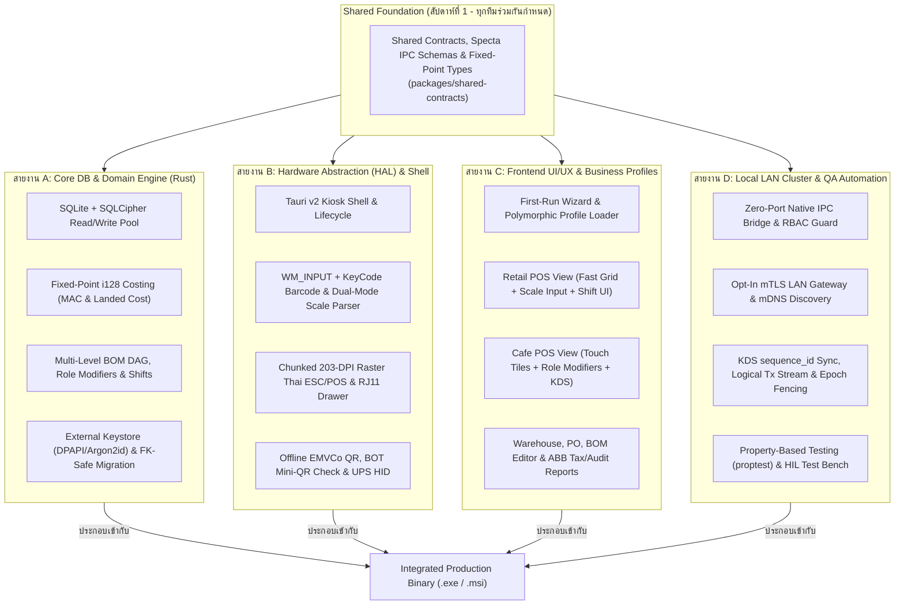

# IMPLEMENTATION_PLAYBOOK.md: คู่มือการแบ่งงานและขั้นตอนการประกอบโปรเจกต์ RUBE-STOCK-POS (v3.1)

**System Name:** RUBE-STOCK-POS  
**Companion Document:** `ARCHITECTURE.md` (v3.1 Implementation-Hardened Blueprint)  
**Objective:** แผนปฏิบัติการเชิงวิศวกรรมสำหรับแบ่งหน้าที่ในทีมพัฒนา (Work Breakdown Structure), กำหนดสัญญาเชื่อมต่อระหว่างโมดูล (Interface Contracts), และขั้นตอนการประกอบร่างโปรเจกต์ทีละส่วนจนพร้อมใช้งานจริง  

---

## 1. โครงสร้างทีมและการแบ่งสายงาน (Team Topology & Role Allocation)

เพื่อให้ทีมงานสามารถพัฒนาคู่ขนานกันได้โดยไม่ติดคอขวด (Zero-Bottleneck Parallel Development) โครงสร้างการทำงานจึงล็อกสเปกเป็น **Tauri v2 (Rust Native Core) + React 19 + TypeScript (`specta` Auto-Generated IPC Contracts)** และแบ่งออกเป็น **4 สายงานหลัก (Workstreams / Squads)** ตามเลเยอร์ใน `ARCHITECTURE.md` ดังนี้:



### ตารางกำหนดบทบาทและขอบเขตความรับผิดชอบของแต่ละสายงาน

| สายงาน (Squad / Role) | ทักษะหลักที่ต้องการ | โมดูลที่รับผิดชอบหลัก | ผลลัพธ์ที่ต้องส่งมอบ (Deliverables) |
| :--- | :--- | :--- | :--- |
| **Squad A: Core Database & Domain Engine** (Backend / Rust Engineer 1–2 คน) | Rust (`rusqlite`, `tokio`), SQLite/SQLCipher, คณิตศาสตร์การเงิน (`i128`), Cryptography | `Storage_Layer`, `INV_SVC`, `BOM_SVC`, `PO_SVC`, `SALES_SVC`, `MIGRATE_SVC`, `BACKUP_SVC` | เอนจินฐานข้อมูล SQLCipher, คิวอ่าน-เขียนแยกส่วน, สูตรคำนวณ MAC/BOM ด้วย `i128`, ระบบกะ `pos_shifts`, ระบบ `keystore.manifest.json` (DPAPI + `.recovery-kit`), และระบบสำรองข้อมูลลง USB |
| **Squad B: Hardware (HAL) & Desktop Shell** (Hardware / Desktop Engineer 1–2 คน) | Tauri v2, Windows Win32 (`WM_INPUT`/HID API), USB/Serial, Canvas Rasterization, ESC/POS | `Desktop_Container`, `SCANNER_HAL`, `PRINTER_HAL`, `DRAWER_HAL`, `PAYMENT_HAL`, `UPS_HAL` | ตัวดักบาร์โค้ดระดับ USB Raw Input + Physical KeyCode, ไดรเวอร์พิมพ์ใบเสร็จภาษาไทยโหมดภาพหั่นแถบ (`Chunked GS v 0`), โมดูลสร้าง QR พร้อมเพย์และตรวจโครงสร้าง BOT Mini-QR, ระบบเชื่อมต่อ UPS |
| **Squad C: Frontend UI/UX & Profiles** (Frontend Engineer 1–2 คน) | React 19, TypeScript, Tailwind CSS, State Management, Touchscreen/Keyboard UX | `Presentation_Layer` ทั้งหมด (`POS_VIEW`, `KDS_VIEW`, `INV_VIEW`, `PO_VIEW`, `BOM_VIEW`, `WIZARD_VIEW`) | หน้าจอติดตั้งครั้งแรก, หน้าจอเปิด-ปิดกะเงินสด, หน้าจอขายโหมดค้าปลีก/คาเฟ่/ไฮบริด, หน้าต่างยืนยันโลโก้ธนาคารและยอดเงินสลิป, หน้าจอครัว KDS, หน้าจอจัดการสต็อกและผูกสูตร BOM |
| **Squad D: Local Cluster, Security & QA** (Network / QA Engineer 1 คน) | Rust (`axum`, `rustls`), mTLS/PKI, mDNS, WebSocket, Property-Based Testing (`proptest`), CI/CD | `IPC_BRIDGE`, `LAN_GW`, `AUTH_GUARD`, `HA_SYNC`, ชุดทดสอบอัตโนมัติ และ EV Code Signing Pipeline | ระบบสื่อสาร IPC/mTLS, ระบบค้นหาเครื่องแม่ข่ายอัตโนมัติในวงแลน, ระบบซิงค์จอครัวและเครื่องสำรองด้วย `global_tx_seq` + `cluster_epoch` (ป้องกัน Split-Brain), และชุดทดสอบสมการทางบัญชีอัตโนมัติ |

*(หมายเหตุ: หากทีมมีขนาดเล็ก เช่น 2–3 คน สามารถควบรวม **Squad A + D** เป็นฝั่ง Backend/Rust Core และ **Squad B + C** เป็นฝั่ง Client/Hardware ได้ทันทีโดยใช้โครงสร้างแบ่งโมดูลเดียวกัน)*

---

## 2. โครงสร้างโฟลเดอร์โปรเจกต์มาตรฐาน (Monorepo Directory Structure)

เพื่อไม่ให้เกิดปัญหาโค้ดชนกัน (Merge Conflicts) เวลาทำหลายส่วนพร้อมกัน ให้จัดวางโครงสร้างโปรเจกต์แบบแยกแพ็กเกจชัดเจนดังนี้:

```text
rube-stock-pos/
├── ARCHITECTURE.md                  # เอกสารสถาปัตยกรรมระบบฉบับสมบูรณ์ (v3.1)
├── IMPLEMENTATION_PLAYBOOK.md       # เอกสารแผนการลงมือทำและแบ่งงานฉบับนี้
├── package.json                     # Frontend Workspace configuration
├── Cargo.toml                       # Rust Workspace (Tauri v2 + Core Crates)
│
├── packages/
│   ├── shared-contracts/            # [ทุกทีมใช้ร่วมกัน] Auto-generated TypeScript & Rust DTOs (via specta)
│   │   ├── src/
│   │   │   ├── fixed-point.ts       # ประเภทข้อมูล MilliUnit, Satang, MicroBahtString, BasisPoints
│   │   │   ├── ipc-commands.ts      # ชื่อคำสั่งและ Payload สำหรับคุยกันระหว่าง UI กับ Rust Backend
│   │   │   ├── hal-events.ts        # โครงสร้าง Event จากเครื่องสแกนบาร์โค้ด, เครื่องพิมพ์, และ UPS
│   │   │   └── mocks/               # ข้อมูลจำลองเพื่อให้ทีม UI และ HAL ทำงานได้โดยไม่ต้องรอ DB เสร็จ
│   │
│   ├── ui-presentation/             # [Squad C รับผิดชอบ] React 19 + Tailwind CSS Frontend
│   │   ├── src/
│   │   │   ├── profiles/            # ตัวจัดการโหมด RETAIL, HOSPITALITY, HYBRID
│   │   │   ├── views/
│   │   │   │   ├── wizard/          # First-Run Setup, Scanner Setup Barcode & Recovery Kit Export
│   │   │   │   ├── shift-drawer/    # เปิด-ปิดกะ (pos_shifts), นำเงินเข้า-ออกลิ้นชัก (Paid In/Out)
│   │   │   │   ├── pos-retail/      # ตารางขายความเร็วสูงสำหรับซูเปอร์มาร์เก็ต
│   │   │   │   ├── pos-cafe/        # ปุ่มเมนูสัมผัส + เลือกความหวาน/ท็อปปิ้งตามบทบาท + Visual Slip Check
│   │   │   │   ├── kds/             # หน้าจอรับออเดอร์ในครัว (Kitchen Display System)
│   │   │   │   ├── inventory/       # คลังสินค้า, ใบสั่งซื้อ (PO + Landed Cost), นับสต็อก
│   │   │   │   └── bom-editor/      # หน้าจอผูกสูตรการผลิต (Pre-built / Phantom) และตรวจสอบกราฟ DAG
│   │   │   └── hooks/
│   │   │       └── usePhysicalScanner.ts # Hook ดักจับ WM_INPUT + KeyboardEvent.code (พร้อม First-Char Rollback)
│   │
│   ├── core-engine/                 # [Squad A รับผิดชอบ] Storage Pool & Domain Business Engines (Rust)
│   │   ├── migrations/              # สคริปต์ SQL DDL (0001_initial_v3_1_schema.sql - 34 ตาราง) พร้อม Checksum
│   │   ├── src/
│   │   │   ├── db/
│   │   │   │   ├── pool.rs          # SQLCipher Raw Hex Key + 1 Writer FIFO Queue + 8 Reader Pool
│   │   │   │   ├── keyring.rs       # External keystore.manifest.json (DPAPI + Argon2id Envelope)
│   │   │   │   └── migrator.rs      # 5-Step FK-Safe Atomic Migration Runner
│   │   │   ├── domains/
│   │   │   │   ├── math_i128.rs     # ฟังก์ชันคำนวณ i128 round_div ป้องกัน Integer Overflow 100%
│   │   │   │   ├── costing_mac.rs   # คำนวณ MAC + Largest Remainder Landed Cost + Negative Stock Guard
│   │   │   │   ├── bom_dag.rs       # DFS Cycle Detection, Pre-built Stopping Rule & Role Modifiers
│   │   │   │   ├── sales_shift.rs   # Idempotent Checkout, Exact Void Reversal, ABB Tax & Shift Ledger
│   │   │   │   └── backup.rs        # Online Backup + Age Encryption + .part/fsync 14-Shift Ring Buffer
│   │
│   ├── hal-drivers/                 # [Squad B รับผิดชอบ] Hardware Abstraction Layer & Simulators
│   │   ├── src/
│   │   │   ├── scanner/             # WM_INPUT Device Filter, KeyCode Mapper & Dual-Mode Scale Parser (20-29)
│   │   │   ├── printer/             # Chunked Band (64-128px) 203-DPI Raster GS v 0 & Whitespace Skipper
│   │   │   ├── drawer/              # ESC p 0 25 250 Pulse Generator
│   │   │   ├── payment/             # Offline EMVCo PromptPay CRC16 & BOT Slip Mini-QR TLV Parser
│   │   │   ├── ups/                 # USB-HID Battery Monitor -> Trigger WAL Checkpoint
│   │   │   └── simulators/          # จำลองปืนบาร์โค้ด, กระดาษความร้อน, ไฟดับ UPS, และเสียบแฟลชไดรฟ์ USB
│   │
│   └── cluster-gateway/             # [Squad D รับผิดชอบ] IPC Bridge, mTLS LAN & High Availability
│       ├── src/
│       │   ├── ipc_router.rs        # Zero-Port Native IPC Dispatcher
│       │   ├── mdns_discovery.rs    # _rube-pos._tcp.local. Broadcaster & Resolver (with cluster_epoch)
│       │   ├── mtls_ca.rs           # Internal Root CA & 6-Digit PIN Client Cert Issuer
│       │   ├── kds_sync.rs          # WebSocket Broadcaster + sequence_id Gap Recovery
│       │   └── tx_replicator.rs     # Logical global_tx_seq Replicator & Epoch-Fenced Leader Promotion
│
└── tests/
    ├── property-invariants/         # [Squad D + A] ทดสอบสมการบัญชี 4 ข้อด้วย proptest 100,000 รอบ
    └── e2e-integration/             # ทดสอบประกอบร่างตั้งแต่เปิดกะ ยิงบาร์โค้ด ตัดสต็อก จนถึงพิมพ์บิลและปิดกะ
```

---

## 3. กฎการทำงานขนานด้วย "Contract-First & Hardware Simulator" (เริ่มงานพร้อมกันได้ตั้งแต่วันแรก)

ปัญหาคลาสสิกของการทำระบบ POS คือ *"ทีมหน้าบ้านต้องรอทีมฐานข้อมูลทำ API เสร็จ และทีมฮาร์ดแวร์ต้องรอซื้อเครื่องพิมพ์จริงมาเสียบถึงจะเขียนโค้ดได้"* เพื่อขจัดปัญหานี้ ให้ทุกทีมยึดหลักปฏิบัติ 3 ข้อในสัปดาห์แรก:

1. **ล็อกสเปก `packages/shared-contracts` ด้วย `specta` ให้เสร็จใน 3 วันแรก:**
   * ใช้ไลบรารี `specta` คอมไพล์ Struct จากภาษา Rust ออกมาเป็น TypeScript Types อัตโนมัติ โดยกำหนดชื่อฟิลด์ลงท้ายด้วยหน่วยเสมอ (`price_satang: number`, `quantity_milli: number`, `average_cost_micro_baht: string`) ห้ามทำคณิตศาสตร์การเงินในฝั่ง TypeScript และใช้ `Branded Numeric String` สำหรับค่าที่มีโอกาสเกิน $2^{53}-1$
   * เมื่อได้ข้อตกลงแล้ว **Squad C (UI)** สามารถดึงข้อมูลจำลอง (`MockIPCBridge`) มาสร้างหน้าจอขายและหน้าจอคลังสินค้าได้ทันทีตั้งแต่วันที่ 4 โดยไม่ต้องรอ **Squad A (DB)**
2. **สร้าง Virtual Hardware Simulator ใน `packages/hal-drivers/src/simulators`:**
   * **Squad B (HAL)** ต้องสร้างหน้าต่างจำลองฮาร์ดแวร์ (DevTools Overlay) ให้เพื่อนร่วมทีมใช้บนคอมพิวเตอร์ทั่วไปได้ครบทั้ง 4 อุปกรณ์ ได้แก่:
     * **ปุ่มจำลองยิงบาร์โค้ด (Virtual Barcode Gun):** กดปุ่มแล้วส่ง Event ทั้งแบบ `WM_INPUT` และ `KeyboardEvent.code` ความเร็ว $< 50\text{ ms}$ พร้อมโหมดจำลองคีย์บอร์ดภาษาไทยค้างไว้ และจำลองบาร์โค้ดตราชั่งทั้งแบบฝังน้ำหนัก (`20`–`24`) และฝังราคารวม (`25`–`29`)
     * **หน้าต่างดูตัวอย่างใบเสร็จความร้อน (Virtual Thermal Paper Previewer):** รับชุดคำสั่ง Byte Stream ของ `Chunked GS v 0` และ `ESC J n` แล้วแปลงกลับเป็นภาพใบเสร็จ $58\text{ mm}$ / $80\text{ mm}$ แสดงบนหน้าจอทันที ทำให้นักพัฒนาทุกคนทดสอบใบเสร็จภาษาไทยและใบกำกับภาษีอย่างย่อ (ABB) ได้โดยไม่ต้องเปลืองกระดาษจริง
     * **ปุ่มจำลองไฟดับและเสียบแฟลชไดรฟ์ (`Simulate UPS AC_PRESENT=0` & `Simulate USB Insert`):** สำหรับทดสอบการรัน `PRAGMA wal_checkpoint(TRUNCATE);` และการเขียนไฟล์สำรอง `.part` + `fsync` 14 กะย้อนหลังโดยไม่ต้องมีเครื่อง UPS จริง
3. **ห้ามข้ามเลเยอร์โดยตรง (Strict Layer Boundary):**
   * โค้ดใน `ui-presentation` ห้ามเรียก SQLite หรือสั่งพอร์ต USB โดยตรง ต้องส่งคำสั่งผ่าน `IPC_BRIDGE` เท่านั้น เพื่อให้สลับระหว่างโหมดเครื่องเดียว (Standalone IPC) และโหมดลูกข่าย (LAN mTLS) ได้โดยไม่ต้องแก้โค้ดหน้าบ้านแม้แต่บรรทัดเดียว

---

## 4. ขั้นตอนการลงมือทำและประกอบโปรเจกต์ทีละเฟส (Step-by-Step Execution & Assembly Plan)

แผนการพัฒนากำหนดไว้ **5 เฟสหลัก (16 สัปดาห์)** โดยในตอนท้ายของทุกเฟสจะมี **วันประกอบร่าง (Integration Assembly Checkpoint)** เพื่อนำงานของทั้ง 4 สายงานมาเชื่อมเข้าด้วยกัน:

### เฟสที่ 0: วางโครงสร้างพื้นฐานและข้อตกลงร่วม (สัปดาห์ที่ 1)
* **Squad A:** สร้างสคริปต์ `0001_initial_v3_1_schema.sql` (ครบ 34 ตาราง รวม `pos_shifts` และ `cash_drawer_movements`) จากส่วนที่ 4.4 ของ `ARCHITECTURE.md` และเขียนโมดูล `math_i128.rs` สำหรับคำนวณเลขจำนวนเต็ม `MilliUnit` ($\times 10^3$), `Satang` ($\times 10^2$), และ `MicroBaht` ($\times 10^6$) ด้วยตัวแปรระหว่างทาง `i128`
* **Squad B:** ตั้งค่าโปรเจกต์ Tauri v2 Kiosk Shell และสร้าง Virtual Barcode, Virtual Receipt Printer, Virtual UPS & USB Simulator
* **Squad C:** วางโครงสร้าง Design System (Tailwind CSS) ที่รองรับทั้งหน้าจอสัมผัส $4:3$ ($1024 \times 768$) และจอไวด์สกรีน Full HD / 4K พร้อมระบบสลับธีมตาม `store_config`
* **Squad D:** ตั้งค่า Monorepo, ระบบสร้าง Type อัตโนมัติด้วย `specta`, ระบบรัน CI Test, และโครงร่าง `IPC_BRIDGE` พร้อม Mock Router
* **จุดประกอบร่างครั้งที่ 0 (จบสัปดาห์ที่ 1):** รันคำสั่งเปิดโปรแกรม Tauri Desktop Shell ขึ้นมาเห็นหน้าจอโครงร่าง ที่กดปุ่มจำลองยิงบาร์โค้ดและแสดงตัวอย่างใบเสร็จจำลองบนหน้าจอได้สำเร็จ

---

### เฟสที่ 1: แกนฐานข้อมูล SQLCipher ความเร็วสูงและเอนจินคำนวณต้นทุน/สต็อก `i128` (สัปดาห์ที่ 2–4)
* **Squad A (งานหลัก):**
  1. สร้าง **SQLCipher Read/Write Split Pool** ตั้งแต่วันแรก (เปิดใช้งาน `bundled-sqlcipher-vendored-openssl` ด้วยกุญแจ Dev Hex Key, แยก Writer 1 เส้นผ่าน FIFO Queue ที่ใช้ `BEGIN IMMEDIATE` + Reader $4\text{--}8\text{ เส้น}$ ที่ตั้งค่า `query_only = ON`)
  2. พัฒนา `INV_SVC` และ `PO_SVC`: คำนวณการปันส่วนค่าขนส่งแฝง (Landed Cost) ด้วย `i128` Largest Remainder Method และสูตรต้นทุนถัวเฉลี่ยเคลื่อนที่ (MAC) พร้อมตัวป้องกันสต็อกติดลบ ($Q_{\text{curr}} \le 0$)
  3. พัฒนา `BOM_SVC`: อัลกอริทึมตรวจสอบกราฟไม่มีวงจร (DFS DAG Validation), กฎหยุดแตกแขนงเมื่อเจอวัตถุดิบผลิตเตรียมล่วงหน้า (`use_production = 1`), และการปรับสัดส่วนตามบทบาทวัตถุดิบ (`ROLE_SCALE_BPS` เช่น ลดความหวาน `SWEETENER` ลง $50\%$)
* **Squad B:** พัฒนา `SCANNER_HAL` ที่ดักจับทั้งระดับ USB Raw Input (`WM_INPUT`) และ `KeyboardEvent.code` (พร้อม First-Char Rollback ป้องกันอักษรแรกหลุดเข้าช่องค้นหา) และตัวแยกบาร์โค้ดตราชั่งซูเปอร์มาร์เก็ตทั้งโหมดฝังน้ำหนัก (`20`–`24`) และโหมดฝังราคารวม (`25`–`29`)
* **Squad C:** พัฒนาหน้าจอ `INV_VIEW` (จัดการสินค้า/วัตถุดิบ), `PO_VIEW` (รับสินค้าเข้าคลังและกรอกค่าขนส่งแฝง), และ `BOM_VIEW` (ผูกสูตรเมนู กำหนด `component_role` และท็อปปิ้ง)
* **Squad D:** เขียนชุดทดสอบ Property-Based Testing (`proptest`) ตรวจสอบสมการความถูกต้องทางบัญชี 4 ข้อตามส่วนที่ 9.2 ของ `ARCHITECTURE.md` (รวมถึงทดสอบค่าสุดขอบป้องกัน `i64` Overflow)
* **จุดประกอบร่างครั้งที่ 1 (จบสัปดาห์ที่ 4 - Warehouse & Costing Assembly):**
  * เชื่อมหน้าจอ `INV_VIEW`, `PO_VIEW`, และ `BOM_VIEW` ของ Squad C เข้ากับเอนจินฐานข้อมูล SQLCipher จริงของ Squad A ผ่าน `IPC_BRIDGE` ของ Squad D
  * **เกณฑ์ผ่าน:** ทดสอบคีย์ใบรับสินค้าล็อตใหญ่พร้อมค่าขนส่งแฝงโดยไม่เกิด Overflow, ผูกสูตรชานมไข่มุก 2 ระดับ (ทั้งแบบ Pre-built และตัดสด), พยายามผูกสูตรวนลูป (ระบบต้องบล็อกได้), และรันชุดทดสอบยิงธุรกรรมพร้อมกันโดยไม่เกิด `SQLITE_BUSY`

---

### เฟสที่ 2: หน้าจอขาย Dual-Mode POS, ระบบกะเงินสด และการพิมพ์ใบเสร็จแบบ Chunked Raster (สัปดาห์ที่ 5–7)
* **Squad A:** พัฒนา `SALES_SVC` สำหรับเปิด-ปิดกะการทำงาน (`pos_shifts`), บันทึกเงินนำเข้า-ออกลิ้นชัก (`cash_drawer_movements`), บันทึกบิลขายแบบ Idempotent (`idempotency_key`), คำนวณภาษีมูลค่าเพิ่ม 7% (`INCLUSIVE`/`EXCLUSIVE`) พร้อมเลขใบกำกับภาษีอย่างย่อ (`abb_tax_invoice_no`), และการยกเลิกบิล (`VOID_RETURN`) ที่ดึงต้นทุนจริงจาก `inventory_transactions` ย้อนกลับทุกประการ
* **Squad B (งานหลัก):**
  1. พัฒนา `PRINTER_HAL` โหมด **Chunked Band 203-DPI Monochrome Raster (`GS v 0`)** ที่หั่นภาพออกเป็นแถบย่อยความสูง $64\text{--}128\text{ px}$ พร้อมข้ามบรรทัดสีขาวด้วย `ESC J n` (ป้องกันบัฟเฟอร์เครื่องพิมพ์ราคาประหยัดล้น) และคิวสำรองงานพิมพ์เมื่อกระดาษหมด (`QUEUE_MGR`)
  2. พัฒนา `DRAWER_HAL` ส่งสัญญาณพัลส์ `0x1B 0x70 0x00 0x19 0xFA` เปิดลิ้นชักเก็บเงินผ่านพอร์ต RJ11
* **Squad C (งานหลัก):**
  1. พัฒนา `WIZARD_VIEW` สำหรับเลือกโหมดธุรกิจ (`RETAIL`, `HOSPITALITY`, `HYBRID`) ตอนเปิดใช้งานครั้งแรก และหน้าจอเปิด-ปิดกะแคชเชียร์ (`shift-drawer`)
  2. พัฒนาหน้าจอขาย `POS_VIEW` ทั้งโหมดตารางสแกนเร็ว (Retail) และโหมดปุ่มรูปภาพพร้อมหน้าต่างเลือกความหวาน/ท็อปปิ้งตามบทบาทวัตถุดิบ (Cafe Modifiers)
* **Squad D:** พัฒนาระบบตรวจสอบสิทธิ์พนักงานด้วยรหัส PIN (`AUTH_GUARD`) และล็อกการเข้าถึงหน้าจอตามบทบาท (`OWNER`, `MANAGER`, `CASHIER`, `WAREHOUSE`, `KITCHEN`)
* **จุดประกอบร่างครั้งที่ 2 (จบสัปดาห์ที่ 7 - Standalone POS & Hardware Assembly):**
  * ประกอบรวมระบบขายหน้าร้านครบวงจรบนเครื่องเดียว: เปิดกะเงินทอนตั้งต้น $\rightarrow$ ยิงบาร์โค้ดจริง (ขณะที่คีย์บอร์ด Windows ตั้งเป็นภาษาไทย) $\rightarrow$ ขึ้นรายการขายโดยไม่มีอักษรแรกหลุดเข้าช่องค้นหา $\rightarrow$ กดรับชำระเงินสด $\rightarrow$ เตะลิ้นชักเก็บเงิน $\rightarrow$ พิมพ์ใบเสร็จยาว 30 ซม. ออกเครื่องพิมพ์ความร้อนจริงโดยสระไม่ลอยและบัฟเฟอร์ไม่ล้น $\rightarrow$ ตัดสต็อกและปิดกะนับเงินสดตรงตามสมการบัญชี

---

### เฟสที่ 3: External Keystore (DPAPI + Argon2id), พร้อมเพย์ออฟไลน์ และระบบตรวจสลิป BOT Mini-QR (สัปดาห์ที่ 8–10)
* **Squad A (งานหลัก):**
  1. พัฒนา `keyring.rs` จัดการไฟล์ **`%PROGRAMDATA%\RubePOS\keystore.manifest.json`** นอกฐานข้อมูล (แก้ปัญหา Bootstrap Paradox): ผูกกุญแจ Slot ที่ 1 เข้ากับ **Windows DPAPI + TPM 2.0** (เพื่อให้เปิดเครื่องตอนเช้าได้โดยไม่ต้องกรอกรหัสเจ้าของร้าน) และผูกกุญแจ Slot ที่ 2 ด้วย **`Argon2id`** เก็บไว้ทั้งใน `keystore.manifest.json` และส่งออกเป็นไฟล์กู้คืน `.recovery-kit`
  2. พัฒนาระบบป้องกันการแอบเปลี่ยนเลขบัญชีพร้อมเพย์ (`is_protected = 1` + `HMAC-SHA256` + `security_audit_logs`)
* **Squad B (งานหลัก):**
  1. พัฒนา `PAYMENT_HAL`: สร้าง Dynamic QR Code พร้อมเพย์ตามมาตรฐาน EMVCo (Tag `01`=`12`, Tag `54` ยอดเงิน, และ CRC16-CCITT `0x1021`) แบบออฟไลน์ 100%
  2. พัฒนาตัวอ่านโครงสร้าง TLV ของ **BOT Slip Mini-QR** ด้วยเครื่องสแกนบาร์โค้ด 2D เพื่อดึงรหัสธนาคาร (`sender_bank_code`) และ `TransRef` มาทำแฮช `SHA-256` (`slip_trans_ref_hash`) ป้องกันการใช้สลิปซ้ำและบล็อกการยิงบาร์โค้ดผิดประเภท
* **Squad C:** พัฒนาหน้าจอรับชำระเงินด้วย QR พร้อมเพย์, **หน้าต่างยืนยันความถูกต้องของสลิปความคมชัดสูง (แสดงโลโก้ธนาคารต้นทาง + 4 ตัวท้าย TransRef + ยอดเงินขนาดใหญ่)**, หน้าจอตั้งค่าความปลอดภัยของเจ้าของร้าน, และหน้าจอกู้คืนข้อมูลจากรหัสผ่านหลักหรือไฟล์ `.recovery-kit`
* **Squad D:** พัฒนาการบังคับปิดพอร์ตเครือข่ายทั้งหมด 100% เมื่ออยู่ในโหมด Standalone (IPC-Only Isolation) และทดสอบเจาะระบบเบื้องต้น
* **จุดประกอบร่างครั้งที่ 3 (จบสัปดาห์ที่ 10 - Security & Anti-Fraud Assembly):**
  * ทดสอบรีสตาร์ทเครื่อง POS เข้าหน้าล็อกอินพนักงานอัตโนมัติ (DPAPI), ทดสอบจำลองเหตุการณ์รีเซ็ตรหัสผ่าน Windows บนเครื่องเดิมแล้วปลดล็อกด้วยรหัสเจ้าของร้านผ่าน `keystore.manifest.json`, ทดสอบกู้ไฟล์ `.db` ข้ามเครื่องด้วย `.recovery-kit`, ทดสอบเปลี่ยนเลขพร้อมเพย์แล้วเครื่องพิมพ์พิมพ์ใบแจ้งเตือนออกทันที, และทดสอบยิงสลิปโอนเงินใบเดิมซ้ำ 2 ครั้ง (ระบบต้องบล็อกครั้งที่ 2 ทันที)

---

### เฟสที่ 4: ระบบเครือข่ายหลายจุดขาย (mDNS + mTLS), จอครัว KDS และ Logical Failover ป้องกัน Split-Brain (สัปดาห์ที่ 11–13)
* **Squad D (งานหลัก):**
  1. พัฒนาระบบค้นหาเครื่องแม่ข่ายอัตโนมัติด้วย **mDNS (`_rube-pos._tcp.local.`)** ที่แนบค่า `cluster_epoch`
  2. พัฒนา **Internal Root CA** และระบบจับคู่เครื่องลูกข่ายด้วยรหัส **6-Digit Pairing PIN** เพื่อออกใบรับรอง Client Certificate สำหรับคุยผ่าน **mTLS**
  3. พัฒนาระบบซิงค์ออเดอร์เข้าจอครัวผ่าน WebSocket พร้อมกลไกดึงข้อมูลย้อนหลังอัตโนมัติจาก `sequence_id` (`last_acked_kds_seq`) เมื่อ Wi-Fi หลุด
  4. พัฒนา `tx_replicator.rs`: ส่งสตรีมธุรกรรมเชิงตรรกะ (`global_tx_seq` Logical Transaction Stream + Online Backup Snapshot) ไปยังเครื่องแคชเชียร์สำรอง (Warm Standby) พร้อมฟีเจอร์โปรโมตขึ้นเป็นเครื่องหลักที่บวกค่า **`cluster_epoch + 1`** และบังคับให้เครื่องหลักเดิมเข้าโหมด Read-Only Quarantine อัตโนมัติเมื่อกลับเข้าวงแลน (ป้องกัน Split-Brain 100%)
* **Squad C:** พัฒนาหน้าจอ `KDS_VIEW` (แสดงคิวอาหารแยกตามสถานีครัว, กดเปลี่ยนสถานะ กำลังทำ $\rightarrow$ เสร็จแล้ว, แจ้งเตือนเสียง) และหน้าจอตั้งค่าจับคู่เครื่องลูกข่ายในวงแลน
* **Squad A:** ปรับแต่งประสิทธิภาพคิวการเขียนเมื่อรับคำขอจากหลายเครื่องลูกข่ายพร้อมกัน และตรวจสอบการทำงานของ `idempotency_key` ร่วมกับ `global_tx_seq`
* **Squad B:** รองรับการสั่งพิมพ์ใบส่งครัวแยกตามหมวดหมู่อาหาร (`kitchen_station`) ออกเครื่องพิมพ์เครือข่าย (TCP Port `9100`)
* **จุดประกอบร่างครั้งที่ 4 (จบสัปดาห์ที่ 13 - Multi-Terminal LAN Cluster Assembly):**
  * ตั้งวงแลนจำลองร้านอาหารที่มีเครื่องหลัก 1 เครื่อง, เครื่องแคชเชียร์ลูกข่าย 1 เครื่อง, และจอครัว KDS 1 จอ
  * **เกณฑ์ผ่าน:** ทดสอบรีสตาร์ทเราเตอร์ให้ IP เปลี่ยน (เครื่องลูกข่ายต้องหาเครื่องหลักเจอเองผ่าน mDNS), ทดสอบดึงสายแลนจอครัวออกขณะสั่งอาหาร 5 บิลแล้วเสียบกลับเข้าไป (ออเดอร์ทั้ง 5 บิลต้องเด้งขึ้นจอครัวครบ 100%), และทดสอบปิดเครื่องหลัก $\rightarrow$ กด Promote เครื่องที่ 2 (เพิ่ม `cluster_epoch`) $\rightarrow$ เปิดเครื่องที่ 1 กลับเข้ามาในวงแลน (เครื่องที่ 1 ต้องล็อกตัวเองเป็น Read-Only Quarantine ทันทีโดยไม่เกิด Split-Brain)

---

### เฟสที่ 5: ระบบอัปเกรดฐานข้อมูล, สำรองข้อมูลลง USB อัตโนมัติ, เชื่อมต่อ UPS และแพ็กเกจส่งมอบ (สัปดาห์ที่ 14–16)
* **Squad A (งานหลัก):**
  1. พัฒนา `MIGRATE_SVC` ตามโปรโตคอล 5 ขั้นตอน (Quiesce $\rightarrow$ `PRAGMA foreign_keys = OFF` นอก Transaction $\rightarrow$ DDL + `PRAGMA foreign_key_check` $\rightarrow$ `PRAGMA foreign_keys = ON` $\rightarrow$ Resume) พร้อมระบบ Auto-Rollback จากไฟล์ Snapshot หากล้มเหลว
  2. พัฒนา `BACKUP_SVC`: สำรองข้อมูลอัตโนมัติเมื่อปิดกะหรือเสียบ USB Flash Drive โดยเขียนเป็นไฟล์ `.part` $\rightarrow$ เรียก `FlushFileBuffers` / `fsync` $\rightarrow$ เปลี่ยนชื่อเป็น `.db.enc` และหมุนเวียนเก็บย้อนหลัง **14 กะ (Ring Buffer)**
* **Squad B (งานหลัก):** พัฒนา `UPS_HAL` ดักสถานะแบตเตอรี่เครื่องสำรองไฟผ่าน USB-HID เมื่อไฟดับ (`AC_PRESENT = 0`) ให้สั่งรัน `PRAGMA wal_checkpoint(TRUNCATE);` ทันทีและแจ้งเตือนบนหน้าจอ
* **Squad C:** พัฒนาหน้าจอรายงานการเงินและบัญชี (`REPORT_VIEW`: รายงานปิดกะ Z-Report, รายงานภาษีขายใบกำกับภาษีอย่างย่อ ABB, รายงานมูลค่าสต็อกคงเหลือ, รายงาน COGS และกำไรขั้นต้นรายเมนู) และหน้าจอจัดการการสำรองข้อมูล
* **Squad D:** ตั้งค่าท่อส่งมอบซอฟต์แวร์ (Release Pipeline), ทำ **EV Code Signing** ให้กับไฟล์ติดตั้ง `.exe` / `.msi`, และรันการทดสอบภาคสนาม (User Acceptance Testing - UAT)
* **จุดประกอบร่างขั้นสุดท้าย (จบสัปดาห์ที่ 16 - Production Release Assembly):**
  * ทดสอบติดตั้งไฟล์ `.msi` บนเครื่อง Windows 11 สะอาดแบบไม่ต่ออินเทอร์เน็ต, ทดสอบชักปลั๊กไฟเครื่องสำรองไฟ UPS, ทดสอบดึง USB ออกขณะสำรองข้อมูล, และทดสอบอัปเกรดเวอร์ชันโปรแกรมแบบ Air-Gapped

---

## 5. ตารางแจกจ่ายงานรายโมดูลและลำดับการพึ่งพา (Master Work Breakdown Structure - WBS)

ตารางนี้ใช้สำหรับติดตามสถานะงานในระบบจัดการโปรเจกต์ (เช่น Jira, Linear, หรือ GitHub Projects) โดยระบุชัดเจนว่างานใดเริ่มได้ทันที และงานใดต้องรอโมดูลอื่น:

| รหัสงาน | ชื่อโมดูล / ชิ้นงานย่อย | สายงานที่รับผิดชอบ | งานที่ต้องเสร็จก่อน (Dependencies) | สัญญาเชื่อมต่อ (Input / Output Contract) | เกณฑ์ตรวจรับงาน (Definition of Done) |
| :---: | :--- | :---: | :---: | :--- | :--- |
| **WBS-01** | Shared Fixed-Point Types & Specta IPC Contracts | ทุกทีม (นำโดย D) | *ไม่มี (เริ่มวันแรก)* | `fixed-point.ts`, `ipc-commands.ts` | สร้าง Type จาก Rust อัตโนมัติ คอมไพล์ผ่านทั้งฝั่ง UI และ Backend พร้อมชุดข้อมูลจำลองครบทุกหน้าจอ |
| **WBS-02** | SQLite DDL Schema v3.1 (34 Tables) & Triggers | Squad A | WBS-01 | `0001_initial_v3_1_schema.sql` | สร้างตารางครบ 34 ตาราง (รวม `pos_shifts`) และทดสอบ `UPDATE`/`DELETE` บน `inventory_transactions` ต้องถูกบล็อก 100% |
| **WBS-03** | SQLCipher Read/Write Split Pool (`BEGIN IMMEDIATE`) | Squad A | WBS-02 | `DatabasePool::execute_write()`, `execute_read()` | เปิดใช้ SQLCipher ตั้งแต่วันแรก ยิงคำสั่งอ่าน-เขียนพร้อมกัน 10,000 ครั้งโดยไม่เกิด `SQLITE_BUSY` แม้แต่ครั้งเดียว |
| **WBS-04** | External Keystore (`keystore.manifest.json`) & Recovery | Squad A | WBS-03 | `KeyringService::unlock_auto()`, `recover_from_kit()` | เปิดโปรแกรมเข้าหน้า PIN ได้ทันทีบนเครื่องเดิม, ปลดล็อกหลังรีเซ็ตรหัส Windows ได้, และใช้ `.recovery-kit` ข้ามเครื่องได้ |
| **WBS-05** | `i128` MAC Costing, Landed Cost & Stock Guard | Squad A | WBS-03 | `CostingEngine::receive_po()` | คำนวณด้วย `i128` ไม่เกิด Overflow, ปันส่วนค่าขนส่งตรงยอดรวม 100%, และเมื่อสต็อก $\le 0$ ต้นทุนใหม่เท่ากับล็อตที่รับเข้า |
| **WBS-06** | Multi-Level BOM (Pre-built Stop) & Role Modifiers | Squad A | WBS-03 | `BomEngine::validate_dag()`, `deduct_recipe()` | บล็อกสูตรวนลูปใน $< 5\text{ ms}$, หยุดแตกแขนงที่โหนด `use_production=1`, และลดวัตถุดิบตาม `component_role` (`SWEETENER`) แม่นยำ |
| **WBS-07** | `WM_INPUT` + KeyCode Scanner & Dual Scale Parser | Squad B | WBS-01 | `ScannerHal::onBarcodeDetected(code, qty_milli)` | ยิงบาร์โค้ดขณะคีย์บอร์ดเป็นภาษาไทยได้ 100% โดยไม่มีอักษรแรกหลุดเข้าช่องค้นหา และแยกบาร์โค้ดตราชั่งได้ทั้งน้ำหนักและราคา |
| **WBS-08** | Chunked 203-DPI Raster Thai ESC/POS & Spool Queue | Squad B | WBS-01 | `PrinterHal::printRasterReceipt(receiptDto)` | หั่นแถบ `GS v 0` ($64\text{--}128\text{ px}$) พิมพ์ภาษาไทยไม่สระลอยและบัฟเฟอร์ไม่ล้น พร้อมเก็บงานเข้าคิวเมื่อกระดาษหมด |
| **WBS-09** | Offline EMVCo PromptPay & BOT Slip Mini-QR Check | Squad B | WBS-01, WBS-03 | `PaymentHal::generateDynamicQr()`, `verifySlipRef()` | สแกน QR ขึ้นยอดตรงตามบิล, ตรวจโครงสร้าง BOT Mini-QR บล็อกสลิปซ้ำ และส่งรหัสธนาคารขึ้นหน้าจอยืนยันยอดเงิน |
| **WBS-10** | First-Run Wizard, Shift UI & Polymorphic Profiles | Squad C | WBS-01 | `ProfileContext`, `WIZARD_VIEW`, `SHIFT_VIEW` | เลือกโหมดธุรกิจแล้ว UI ปรับเปลี่ยนทันที พร้อมรองรับการเปิด-ปิดกะและบันทึกเงินทอนเข้า-ออกลิ้นชัก |
| **WBS-11** | Retail High-Speed POS & Cafe Touch POS Views | Squad C | WBS-01, WBS-10 | `POS_VIEW` (เชื่อม `IPC_BRIDGE`) | โหมดค้าปลีกรับบาร์โค้ดต่อเนื่องทันที โหมดคาเฟ่เลือกความหวานตามบทบาทได้ใน 2 สัมผัส และแสดงหน้าต่างตรวจยอดสลิปชัดเจน |
| **WBS-12** | Inventory, PO Landed Cost & BOM DAG Views | Squad C | WBS-01, WBS-05, WBS-06 | `INV_VIEW`, `PO_VIEW`, `BOM_VIEW` | แสดงต้นทุนถัวเฉลี่ยและปันส่วนค่าขนส่งแบบเรียลไทม์ก่อนกดยืนยันรับของเข้าคลัง |
| **WBS-13** | Zero-Port IPC Bridge & Opt-in mTLS LAN Gateway | Squad D | WBS-01, WBS-04 | `IpcBridge`, `LanGateway` | โหมดเครื่องเดียวตรวจด้วย `netstat` ต้องไม่พบพอร์ตเปิดอยู่ และโหมด LAN ต้องบังคับใช้ใบรับรอง mTLS ทุกคำขอ |
| **WBS-14** | mDNS Discovery, KDS Sync & Epoch-Fenced Failover | Squad D + C | WBS-13 | `KDS_VIEW`, `TxReplicator` | ค้นหาเครื่องแม่ข่ายผ่าน `_rube-pos._tcp.local.`, ซิงค์ด้วย `global_tx_seq`, และกั้น Split-Brain ด้วย `cluster_epoch` |
| **WBS-15** | 5-Step FK-Safe Migration, Atomic USB & UPS HID | Squad A + B | WBS-03, WBS-08 | `MigrationRunner`, `UsbBackupEngine`, `UpsHal` | อัปเกรดฐานข้อมูลพร้อมตรวจ `foreign_key_check`, เขียนไฟล์ลง USB แบบ `.part`+`fsync` 14 กะ, และสั่ง Checkpoint เมื่อไฟดับ |

---

## 6. ระเบียบการรวมโค้ดและขั้นตอนการตรวจสอบก่อนส่งมอบ (Integration Rituals & Assembly Checklist)

เพื่อให้การประกอบชิ้นงานจากทั้ง 4 สายงานเป็นไปอย่างราบรื่นโดยไม่มีบั๊กหลุดรอดไปถึงมือลูกค้า ทีมพัฒนาต้องปฏิบัติตามขั้นตอนต่อไปนี้ในทุกสัปดาห์:

### 6.1. กฎการส่ง Pull Request (PR Gatekeeping Rules)
1. **Static Analysis สำหรับหน่วยเงิน สต็อก และ `i128` Intermediate Math:** ห้ามใช้ชนิดข้อมูลทศนิยม (`f32`/`f64` ใน Rust หรือการคำนวณเงินใน TypeScript) โดยเด็ดขาด และทุกการคูณ/หารต้นทุนใน `core-engine` ต้องแปลงผ่าน `i128` (`math_i128::round_div`) เสมอ
2. **Contract Compatibility Check:** การแก้ไข Struct ที่ส่งออกไปยัง `packages/shared-contracts/` ต้องรัน `cargo test --package shared-contracts` เพื่ออัปเดตไฟล์ TypeScript อัตโนมัติ และได้รับการอนุมัติจากตัวแทนของทั้ง **Squad A, B, C, และ D**
3. **Automated Invariant Suite:** ทุก PR ที่แก้ไขโค้ดใน `packages/core-engine/` ต้องรันชุดทดสอบ Property-Based Testing ครบทั้ง 4 สมการบัญชี (100,000 รอบ) ผ่าน 100% บน CI Pipeline

### 6.2. รายการตรวจสอบการประกอบร่างบนชุดทดสอบฮาร์ดแวร์จริง (Hardware-in-the-Loop Assembly Bench)
ก่อนปิดแต่ละเฟส ทีมงานต้องรันการทดสอบบนเครื่องคอมพิวเตอร์ Windows ทดสอบจริงที่เสียบอุปกรณ์ครบชุด (เครื่องสแกนบาร์โค้ด 2D, เครื่องพิมพ์ใบเสร็จความร้อน 58/80mm, ลิ้นชักเก็บเงิน RJ11, เครื่องสำรองไฟ UPS, และ USB Flash Drive) ตามรายการตรวจสอบดังนี้:

- [x] **1. ทดสอบคีย์บอร์ดภาษาไทยค้างและป้องกันอักษรแรกหลุด (Thai Input & Zero-Leakage Immunity):** คลิกเคอร์เซอร์วางไว้ในช่องค้นหา กดสลับภาษาบน Windows เป็นภาษาไทย (`กขค`) แล้วใช้ปืนสแกนบาร์โค้ดยิงสินค้า 10 ชิ้นรวดและยิงบาร์โค้ดตราชั่งทั้งแบบฝังน้ำหนัก (`20`) และฝังราคา (`25`) — ระบบต้องค้นหาสินค้าและคำนวณน้ำหนักเจอครบ 100% โดยไม่มีอักษรไทยหลุดค้างในช่องค้นหาแม้แต่ตัวเดียว
- [x] **2. ทดสอบพิมพ์ใบเสร็จยาว 30 ซม. สระไทยไม่ลอย และบัฟเฟอร์ไม่ล้น:** สั่งพิมพ์ใบเสร็จที่มีรายการสินค้า 30 รายการและชื่อเมนูภาษาไทยที่มีวรรณยุกต์ซ้อน (เช่น *"น้ำผึ้งมะนาวโซดา เพิ่มบุกไข่มุกไต้หวันหวานน้อย"*) — ภาพต้องถูกส่งแบบหั่นแถบ (`Chunked GS v 0`) พิมพ์ต่อเนื่องรวดเร็ว สระไม่ลอย บัฟเฟอร์เครื่องพิมพ์ไม่ล้น ลิ้นชักเด้งเปิดทันที และตัดกระดาษอัตโนมัติ
- [x] **3. ทดสอบกระดาษหมดกลางคัน (Spool Queue Resilience):** เปิดฝาเครื่องพิมพ์ออกขณะกดปิดบิล — หน้าจอ POS ต้องแจ้งเตือนว่าเครื่องพิมพ์ไม่พร้อมโดยที่บิลถูกบันทึกสำเร็จ และเมื่อปิดฝาเครื่องพิมพ์กลับเข้าไป ใบเสร็จต้องพิมพ์ออกมาเองโดยไม่ตัดสต็อกซ้ำ
- [x] **4. ทดสอบสลิปซ้ำและหน้าต่างยืนยันยอดเงินป้องกันสลิปตัดต่อ (BOT Mini-QR + Visual Check):** สร้างบิลรับชำระด้วยพร้อมเพย์ QR แล้วใช้ปืนสแกน 2D ยิง Mini-QR บนสลิป — ครั้งแรกต้องขึ้นโลโก้ธนาคารต้นทางและยอดเงินขนาดใหญ่ให้กดยืนยัน และเมื่อนำสลิปใบเดิมมายิงซ้ำในบิลถัดไป ระบบต้องขึ้นหน้าจอสีแดงบล็อกการรับชำระเงินทันที
- [x] **5. ทดสอบสายแลนหลุด, โปรโมตเครื่องสำรองป้องกัน Split-Brain และไฟดับกะทันหัน:** ดึงสายแลนของจอครัวออก 30 วินาทีขณะสั่งอาหารรัวๆ แล้วเสียบกลับ (ออเดอร์ต้องขึ้นครบ), ทดสอบโปรโมตเครื่องที่ 2 ขึ้นเป็น Leader แล้วเสียบเครื่องที่ 1 กลับเข้าวงแลน (เครื่องที่ 1 ต้องเข้าโหมด Read-Only Quarantine ทันที), และดึงปลั๊กไฟของ UPS ออก (ระบบต้องสั่ง Checkpoint ฐานข้อมูลลงดิสก์ทันที)